# Non-technical summary
The Copernicus Land Monitoring Service Protected Areas product provides detailed and harmonised land cover and land use information for Natura 2000 sites across Europe. The 2021 product covers approximately 821,000 km² and 25,011 Natura 2000 sites, creating a common European dataset that can support biodiversity monitoring, conservation assessments and the analysis of changes within protected areas.

The product maps land cover and land use using a hierarchical nomenclature with 59 classes at the most detailed level. The minimum mapping unit is 0.5 ha and the minimum mapping width is 10 m, allowing relatively small and narrow landscape features to be represented. The dataset is distributed as polygon vector data for use in geographic information systems.

Production combines Earth observation imagery and existing reference information. Multi-temporal Sentinel-2 imagery provides information on seasonal and spectral behaviour, while Very High-Resolution satellite imagery supports visual interpretation and manual refinement. Existing Copernicus Land Monitoring Service datasets and other ancillary information are also used to improve thematic consistency and support difficult classification decisions.

The Protected Areas product continues the earlier Natura 2000 land cover and land use mapping series for 2006, 2012 and 2018. The 2021 layer establishes a new baseline with complete terrestrial Natura 2000 coverage and a revised methodology. The 2024 production cycle will provide an updated status layer together with a 2021–2024 change layer.

Potential uses include analysing the distribution and evolution of broad land cover and land use types, identifying areas where changes have occurred, supporting assessments of protected-area management, and combining the information with other Copernicus or biodiversity datasets. For applications requiring detailed habitat condition, species-level information or local ecological interpretation, complementary thematic or field information may still be required.



# Executive summary
Copernicus is the European Union's Earth Observation Programme. It offers information services based on satellite Earth observation and in situ (non-space) data. These information services are freely and openly accessible to its users through six thematic Copernicus services (atmosphere monitoring, marine environment monitoring, land monitoring, climate change, emergency management and security).

The Copernicus Land Monitoring Service (CLMS) provides geographical information on land cover and its changes, land use, vegetation state, water cycle and earth surface energy variables to a broad range of users in Europe and across the world in the field of environmental terrestrial applications. CLMS is jointly implemented by the European Environment Agency and the European Commission DG Joint Research Centre (JRC).

The local component as part of the CLMS is coordinated by the European Environment Agency and aims to provide specific and more detailed information that is complementary to the information obtained through the Pan-European component. The local component focuses on different hotspots, i.e. areas that are prone to specific environmental challenges and problems. It is based on very high-resolution imagery in combination with other available datasets (high and medium resolution images) over the pan-European area.

Natura 2000 sites are important hotspots for nature conservation therefore, the objective of the Protected Areas (PA) product of CLMS is to provide detailed Land Cover / Land Use (LC/LU) mapping results, covering a total of 25,011 Natura 2000 sites and the service covers 821,000 km² of land surface across Europe.

The central aim of the Natura 2000 (N2K) protected areas network is to ensure the long-term survival of Europe's most valuable and threatened species and habitats. Information is still lacking on the effectiveness of conservation measures in Europe's protected areas. The CLMS N2K product aims at filling these gaps through objective and European-wide harmonized information on LC/LU within Natura 2000 sites, directly supporting the analysis of trends and progress in stopping the ongoing loss of biodiversity in Europe. It currently offers two types of products, status maps for the three reference years and two change layer products for the two reference periods and covers 821,000 km² of land surface across Europe. For each selected Natura 2000 site, the former N2K product also covers a 2 km buffer zone.

This is a unique product with a high level of detail (Minimum Mapping Unit (MMU) is 0.5 ha), based on Very High Resolution (VHR) satellite data. The classification provides 59 distinct thematic classes, and the class definitions follow a pre-defined nomenclature based on the Mapping and Assessment of Ecosystems and their Services typology of ecosystems (at level 1) and are further harmonised with Corine Land Cover and adapted to the specific characteristics of grasslands habitats (levels 2 to 4). It offers two types of products: status maps for 2021 reference year and 2024 as well as one change products between those periods.

The N2K former product offers a good basis to analyse the LC/LU situation in grassland- rich Natura 2000 sites and furthermore allows to devise the general trends and change factors within the sites through the observation periods, as well as within the buffer zone surrounding those. CLMS decided to restart the N2K product (from 2021 onwards) with a 3-year interval between inventories (2021 and 2024) and covering all Natura 2000 sites, thereby addressing the spatial and temporal resolution requirements. It was also decided to no longer map the 2 km buffer surrounding the sites. Hereinafter referred to as “CLMS PA", a LC/LU product in a selection of Natura 2000 sites.



# Background of the document

## Scope and objectives
This Product User Manual is the primary document that users are recommended to read before using the CLMS Protected Areas (former N2K) product. It provides an overview of the product characteristics, product methodology and workflows, user requirements and example/potential use cases, information about the quality assessment checks and their results as well as product technical support.

## Content and structure
The document is structured as follows:

*   **Chapter 1** provides a non-technical overview of the product and its intended use.
*   **Chapter 2** provides the executive summary.
*   **Chapter 3** explains the scope, content and structure of this Product User Manual and lists the applicable project documents.
*   **Chapter 4** describes the lineage of the product.
*   **Chapter 5** reviews the main user requirements.
*   **Chapter 6** presents product application areas; example use cases and thematic overlaps.
*   **Chapter 7** describes the product portfolio, characteristics and technical specifications.
*   **Chapter 8** summarises the production methodology, workflow and quality assessment information relevant to users.
*   **Chapter 9** provides the terms of use, citation guidance and product technical support.

The final sections provide the list of abbreviations and acronyms, references and, where applicable, annexes.

## Applicable documents (AD)
The project documents listed in Table 1 provide the detailed technical, validation and nomenclature information supporting this Product User Manual.

Table 1: Applicable project documents

| ID | Document name / content |
|----|-------------------------|
| AD01 | CLMS PA Nomenclature and Mapping Guideline (30/04/2026): not published yet |
| AD02 | PA validation report (2021 database): not published yet |
| AD03 | PA Algorithm Theoretical Basis Document (2021 database): not published yet |



# Lineage of product
The Protected Areas product continues the Copernicus Land Monitoring Service Natura 2000 land cover and land use mapping series produced for the reference years 2006, 2012 and 2018. The earlier product focused on a subset of Natura 2000 sites, particularly grassland-rich areas, and used a six-year update cycle.

Building on that experience and on the user needs described in this manual, the Protected Areas product extends the spatial coverage to all terrestrial Natura 2000 sites included in the service and increases the update frequency to three years. The 2021 status layer provides the new baseline. The 2024 production cycle will provide a new status layer together with a 2021-2024 change layer.

The updated product also introduces a revised production approach based on multi-temporal Sentinel-2 information, Very High-Resolution imagery, existing Copernicus Land Monitoring Service datasets and ancillary information. The nomenclature has been expanded to 59 classes to accommodate the broader diversity of land cover and land use conditions found across the complete Protected Areas domain.



# Review of user requirements
The European Commission has been systematically collecting user needs for Copernicus products and services, expressed in different policy areas. Information on specific aspects of land cover, land use and changes such as provided by this CLMS N2K product are an essential prerequisite to support many policies, reporting and monitoring obligations (European Comission -EC-2019).

The reference baseline for pan-European land cover and land use mapping has traditionally been provided by the Corine Land Cover (CLC) inventory and its complementary High-Resolution Layers. The former CLMS N2K product supplemented these datasets by delivering information at a finer thematic and spatial resolution for a subset of grassland-rich Natura 2000 sites. The new Protected Areas product ensures continuity with the previous N2K dataset while extending the coverage to all terrestrial Natura 2000 sites across the EU27 (European Union 27 Member States), amounting to approximately 821,000 km² and 25,011 sites. Also, PA shows a strong core as a 2,5 m x 2,5 m raster classification derived from the use of super-resolved Sentinel-2 time series and a reliable training dataset coming from Copernicus information feeding Deep Learning models, as well as confidence layers. In addition, the nomenclature has been expanded from 55 to 59 classes to account for the wider diversity of Natura 2000 habitats.

The central objective of the Natura 2000 network is to ensure the long-term conservation of Europe's most valuable and threatened species and habitats. Despite significant progress, information gaps remain regarding the effectiveness of conservation measures and the evolution of ecosystems within protected areas. The Protected Areas product addresses these gaps by providing harmonized Very High Resolution (VHR) land cover and land use information, supporting assessments of ecosystem status and changes across Natura 2000 sites. The previous N2K product demonstrated the value of detailed LC/LU information for analyzing trends in grassland-rich sites. Building on this experience and on recommendations from the Knowledge Centre on Earth Observation (KCEO, Camia et al., 2024), the new product extends the spatial scope to all Natura 2000 habitats and increases the update frequency from six to three years. The 2021 status layer provides the baseline, while the 2024 update includes both a new status layer and a 2021–2024 change layer, enabling improved monitoring of ecosystem dynamics and supporting more timely assessments.

The product supports the implementation of the European Union -EU- Biodiversity Strategy for 2030 and contributes to the monitoring of protected areas, ecological connectivity and conservation effectiveness. It also responds to recommendations identified in the KCEO Biodiversity Deep Dive assessment, which highlighted the need for complete Natura 2000 coverage and increased temporal resolution. Furthermore, the product provides a basis for supporting agri-environmental indicators and future policy requirements by integrating Very High-Resolution imagery with other Copernicus products, Sentinel time series and ancillary data sources.

The new EU Biodiversity Strategy for 2030 makes it clear that for the good of our environment and our economy additional efforts are needed, to deal with the five main direct drivers of biodiversity loss – changes in land and sea use, overexploitation, climate change, pollution, and invasive alien species. The CLMS PA products support the EU Biodiversity Strategy 2030 with specific focus on areas of very high biodiversity value or potential.



# Product application areas and use case examples
The CLMS PA product provides highly detailed and consistent information on Land Cover / Land Use (LC/LU) for approximately 821.000 km² across Europe. It has a thematic depth of 59 different LC/LU classes with a Minimum Mapping Unit (MMU) and Minimum Mapping Width (MMW), i.e. the smallest area to be distinguished, of 0.5 ha and 10 m, respectively.

The product is available for reference years 2006, 2012 and 2018 as N2K and 2021 as PA (reference year) and allows due to its technical setup a direct analysis of LC/LU changes across time using a homogenous data source across Europe. Examples of potential applications include:

*   Monitoring land cover and land use evolution within Natura 2000 sites by comparing status layers from different reference years and, for 2021-2024, using the dedicated change layer.
*   Identifying changes in agricultural, grassland, forest, wetland, urban or water-related land cover within protected areas and prioritising locations for further expert review.
*   Supporting assessments of protected-area context by combining the Protected Areas land cover and land use information with biodiversity, habitat, species or conservation-management datasets.
*   Analysing landscape structure and ecological connectivity by combining the Protected Areas product with complementary Copernicus Land Monitoring Service datasets.
*   Supporting European, national or regional reporting and monitoring activities that require harmonised and spatially detailed land cover and land use information for Natura 2000 sites.

The product should be interpreted according to its thematic definitions, minimum mapping unit, minimum mapping width, reference period and validation results. Applications requiring detailed habitat condition, species-level information or local ecological interpretation may require complementary thematic or in-situ information.

## Thematic overlaps between CLMS and external datasets
The hierarchical CLMS N2K LC/LU nomenclature is highly compatible with the CLMS Local Component Coastal Zone (CZ) and Riparian Zone (RZ) products. Depending on the LC/LU under investigation, these products could be jointly used to analyse LC/LC trends and changes.

The Protected Areas product overlaps thematically with other Copernicus Land Monitoring Service datasets, including Coastal Zones, Riparian Zones, High Resolution Layers and CLCPlus Backbone. These products have different objectives, thematic definitions, spatial characteristics and reference periods and should therefore be considered complementary rather than interchangeable.

Users should select or combine datasets according to the intended application. Protected Areas provides detailed land cover and land use information specifically for the protected-area domain, while other products may provide broader geographic coverage or more specialised thematic information. When several datasets are used together, differences in nomenclature, temporal reference, spatial resolution and mapping rules should be considered.



# Product description and methodology

## Overview of the product portfolio
The CLMS PA product contains two specific information layers for each reference year. The status layer describes the LC/LU situation in the relevant reference year. The change layer describes LC/LU change areas between two reference years. Currently status layers for the reference years 2006, 2012 and 2018 are available as N2K18 (Natura 2000 2018), with corresponding layers for 2006-2012 and 2012-2018. The CLMS PA for 2021 status layer product covers an area of 821.000 km² (Figure 1).

The CLMS PA layers are provided as polygon vector data. They cover 25.011 Natura 2000 sites across Europe (Figure 1), including a 20-meter buffer zone around each site (Figure 2).

The LC/LU classification is based on temporal series of superresolved Sentinel-2 imagery and visual image interpretation from Very High Resolution (VHR) satellite imagery. The characteristics of the product are the following:

*   LC/LU is encoded following a detailed mapping nomenclature and guideline (AD01) into 59 different classes using a hierarchical LC/LU encoding structure ranging from 8 LC/LU classes at Code level 1 to the full 59 classes at Code level 4.
*   LC/LU classes are:
    *   based on the MAES (Mapping and Assessment of Ecosystems and their Services) ecosystem types of specification at Code level 1.
    *   largely compatible with CORINE Land Cover (CLC) and Urban Atlas and adapted to the specific characteristics of grasslands habitats (Code levels 2 to 4).
    *   harmonized with CLMS Riparian Zones and Coastal Zones products.
*   Minimum Mapping Unit is 0.5 ha.
*   Minimum Mapping Width is 10 m.

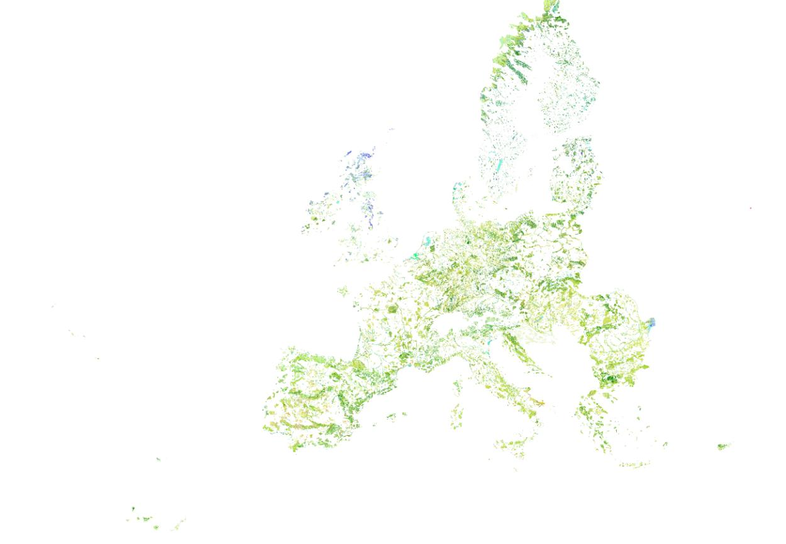{width=417pt}

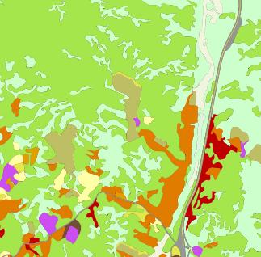{width=238pt}

## Product characteristics

### Natura 2000 boundary changes and the impact in the CLMS N2K product Area of Interest (Aol)
The Aol for mapping the LC/LU was set up, changed and extended throughout the evolution of the CLMS N2K product, in four different phases throughout the N2K-PA history:

Within the **first production phase**, during the initial setup of the N2K Aol under the Global Monitoring for Environment and Security (GMES) Initial Operations (GIO) project phase (GMES Initial Operation Phase in 2014) a selection of Natura 2000 grassland-rich sites (representing five grassland habitat types) as identified in Annex I of the Habitats Directive was used.

A list of Natura 2000 sites was proposed by the Directorate-General for Environment (DG ENV) based on their representativeness and relative importance for the given habitat types. The information about selecting sites based on the above criteria has been taken from the Natura 2000 site's Standard Data Forms in the most recent version of the EU-wide Natura 2000 database at the time.

Based on this list of Natura 2000 site codes the corresponding site boundaries were extracted from the Natura 2000 Database (version: Natura 2000 v2013). This led to an Aol area of around 150.800 km². This led to an AoI area of around 150.800 km².

A GIS (Geographic Information System) and Earth Observation data analysis were then performed to:

* Buffer the Natura 2000 sites by 2 km, which increased the N2K Aol area to around 252.600 km²).
* Identify existing VHR satellite coverage for reference years 2006.
  * ± 1 year (with extension to ± 2 years for gap-filling) and 2012
  * ± 2 years within defined seasonal windows, so that in combination they reach > 80% coverage of the full (buffered) N2000 (Natura 2000) site size (i.e. in the same areas, for both time steps). This reduced the Aol to around 162.600 km² - 173.800 km². 
    
The finally mapped N2K product during the GIO Phase covered 160.443 km².

In the **second production phase** (started in 2016) the N2K Aol was enlarged. Additional Natura 2000 sites were selected, now based on a list of 32 different Annex 1 grassland habitat types as defined under the Habitats Directive. The additional Natura 2000 site boundaries were again taken from the Natura 2000 Database (this time from version: end2015). The buffer was applied to the newly selected sites and minor adaptations to the N2K Aol were made to correct imprecisions and omission errors. This changed the Aol size and geometry in a way that:

*   Missing 2 km buffers were included, for mainly buffers around islands were missing
*   Wrongly clipped buffers of selected N2K sites were included
*   Existing gaps between N2K sites shapefile and EEA39 member states boundary shapefile were filled. Regarding water areas, those gaps over water appeared if EEA39 boundaries do not coincide with N2K site boundaries along coastlines and had also to be corrected and included
*   Minor gaps and spikes between the Aols of the first and second phases were corrected and included
*   Small angles (<20°) were checked and corrected where feasible.

In the end of the second production phase, the existing 160.443km² were complemented by 471.377 km² leading to the N2K product covering 631.820 km² for the reference years 2006 and 2012.

In the **third production phase** (started in 2020 and finished in May 2021) the N2K product is updated to the reference year 2018, including the change layer 2012-2018. No changes were applied to the geographic coverage of the product.

The option taken for the N2K product was to have a stable Aol so that the change mapping exercise could be done within the same area and that the derived statistics were not affected by changing Aol's.

As can be seen from the above “history” of the N2K Aol creation process, there were several input data sets used as well as several geospatial corrections applied to generate the currently used N2K coverage of 631.820km². As stated above there are several factors which prevent a 1:1 relation between the N2K Aol and Natura 2000 site boundaries:

*   Different Natura 2000 database versions were applied to generate the unbuffered N2K site selection (version Natura 2000 v2013 and later version end2015). Changes in the yearly updated Natura 2000 site definitions were not adapted for already mapped N2K sites (Figure 3).
*   N2K Aol adaptations to achieve a technically "clean" dataset may have led to deviations from a strict 2 km buffer zone around each selected Natura 2000 site.
*   The availability of archived VHR satellite data for the reference years 2006 and 2012 required a threshold to produce N2K LC/LU information also for Natura 2000 sites covered by up to a minimum of 80% satellite data.

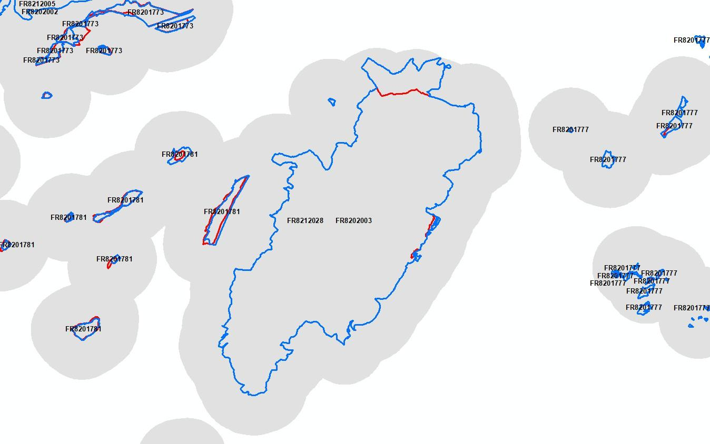{width=402pt}

Also, due to the buffering of the Natura 2000 sites by 2 km, the N2K sites may actually cover more than one Natura 2000 site (Figure 4). This has been one the reasons for the removal of the Natura 2000 Site code from the N2K Aol, to avoid a misinterpretation of the data. Because within the same N2K polygon there could be reference to more than one Natura 2000 site.

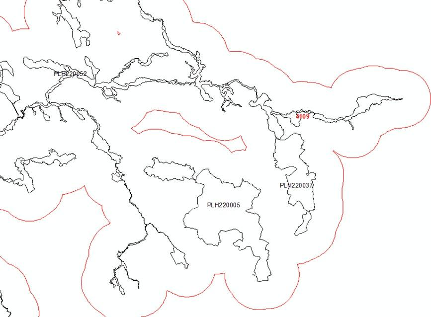{width=424pt}

To quantify the effects of the changing Natura 2000 Database on the N2K products a spatial analysis of the Natura 2000 database changes between 2015 and 2018 was performed.

During the data preparation it became evident, that the Natura 2000 databases are more complex than expected. The Natura 2000 sites are very often defined as “multi-part” polygons (Figure 5). This means that multiple detached areas form together one Natura 2000 site. Due to the above described N2K Aol creation process, Natura 2000 sites are not always covered by the N2K product for all their single areas. This is an important fact, if N2K products are related to Standard Data Form (SDF) information, e.g. Habitat coverage within site, which relates to the complete Natura 2000 site.

For this all Natura 2000 sites affected by the full N2K Aol were selected from the 2015 Natura 2000 Database (version: end2015). This resulted in 3872 different site codes. Performing the same process to the 2018 Natura 2000 Database (version: end2018) led to 3868 site codes. Four site codes have changed between 2015 and 2018. Here the Natura 2000 sites had a newer release data. This was for example the case for the Danish site code DK00BX044 in 2015, which was split up into two new site codes DK00BB396 and DK00BB380 (Figure 6). The four changed site codes were also included in the spatial analysis of the 2018 data.

Other Natura 2000 Database (DB) changes led to a partial coverage of 2018 geometries of formerly fully covered in 2015 (Figure 7). Partially these changes might still be covered by the N2K Aol, but initially the original 2 km buffer around the site is no longer valid for the complete site (Figure 8).

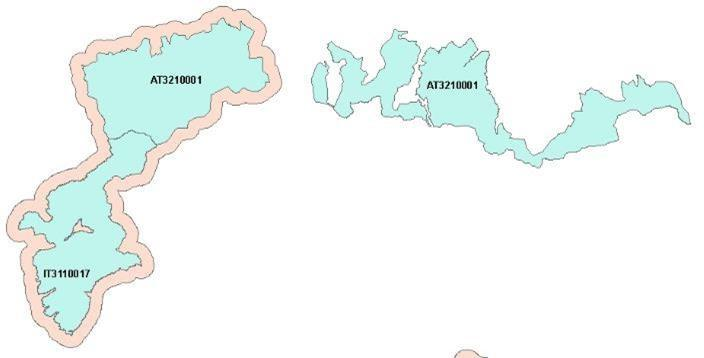{width=325pt}

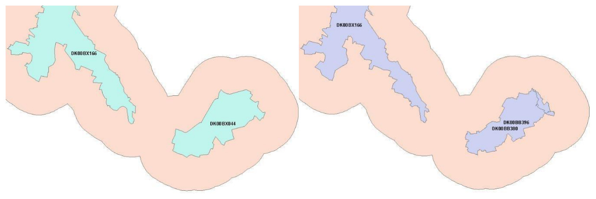{width=431pt}

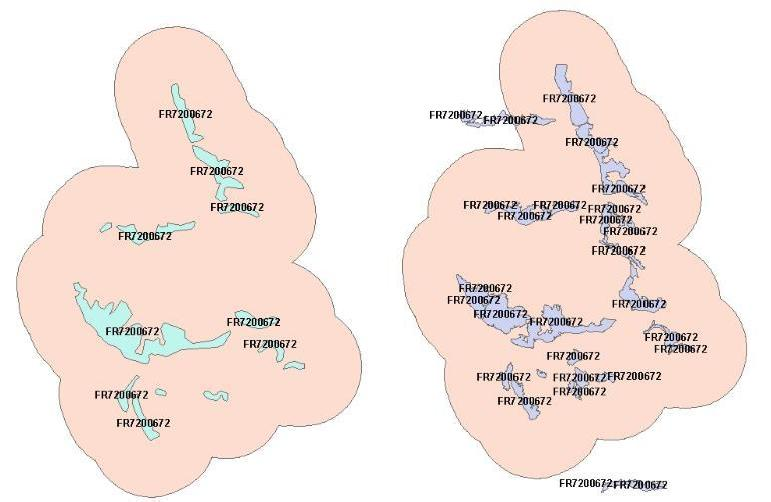{width=378pt}

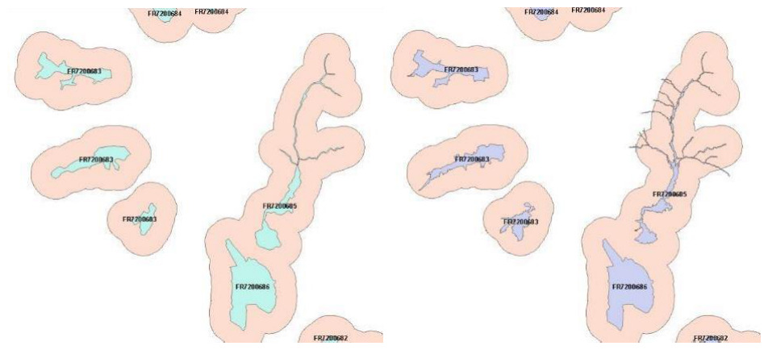{width=433pt}

The Natura 2000 site boundaries were intersected with the N2K Aol for both years to analyse the total area covered by the Natura 2000 sites, and their spatial overlap with the N2K Aol. Due to the fact that there are overlapping geometries in the Natura 2000 sites DB (Figure 10), the analysis was performed also with the Natura 2000 sites merged to one analysis extent.

The results showed that more than 98% of the area covered by the selected grassland-rich Natura 2000 sites is covered by the N2K product in for both Natura 2000 site definitions, version end2015 and end2018 (Figure 4).

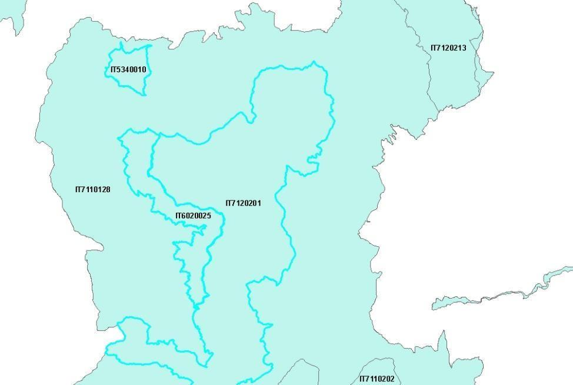{width=433pt}

Table 2: Spatial coverage of Natura 2000 DB sites by N2K Aol in 2015 and 2018

| Area | 2015 | 2018 | Difference 2015-2018 |
|-----------------|-----|-----|--------|
| Total area of Natura 2000 sites (with overlaps) [km²] | 284.195,48 | 284.977,85 | + 782,37 |
| Total area of Natura 2000 sites (without overlaps) [km²] | 272.483,95 | 273.266,93 | + 782,98 |
| Area of Natura 2000 sites (without overlap) covered by N2K AoI [km²] | 267.820,37 | 268.167,05 | + 346,68 |
| Percentage of Natura 2000 area covered by N2K AoI (without overlaps) [%] | 98,3 | 98,1 | - 0,2 |

Comparing the spatial dynamics of the 2015 and 2018 Natura 2000 site boundaries in comparison to the current N2K Aol showed that the selected sites in the 2018 Natura 2000 DB had around 537 km² area removed, which was still contained in the 2015 DB version, whereas around 1.320 km² were newly added in the 2018 DB version. Of this newly added area, 66% was still covered by the unchanged N2K Aol (Figure 5).

Table 3: Area changes for Natura 2000 DB sites from 2015 to 2018

```{=html}
<table>
<thead>
  <tr>
    <th colspan="2">Natura 2000 area changes 2015-2018</th>
    <th>Value</th>
  </tr>
</thead>
<tbody>
  <tr>
    <td colspan="2">Common area in 2015 and 2018</td>
    <td>271.946,91 km²</td>
  </tr>
  <tr>
    <td colspan="2">Area only in 2015 data (removed)</td>
    <td>537,04 km²</td>
  </tr>
  <tr>
    <td colspan="2">Area only in 2018 data (new)</td>
    <td>1.320,02 km²</td>
  </tr>
  <tr>
    <td rowspan="2" style="width: 10%"></td>
    <td>covered by N2K AoI (Inside)</td>
    <td>871,79 km² (66%)</td>
  </tr>
  <tr>
    <td>not covered by N2K AoI (Outside)</td>
    <td>448,23 km² (44%)</td>
  </tr>
</tbody>
</table>
```

The boundaries of Natura 2000 may change from year to year but usually those are not dramatic changes and are usually covered by the 2 km buffer zone. There are, however, a few occasions when a change in extent may have gone over the N2K established Aol. Extreme situation illustrated below (Figure 10).

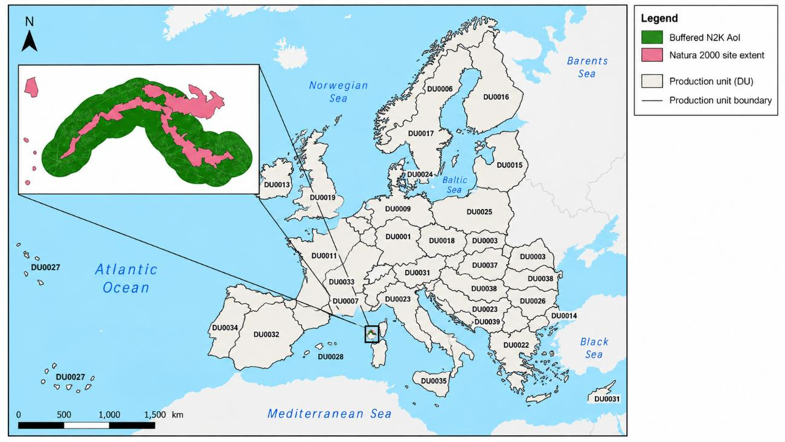{width=433pt}

This was one of the reasons why it was decided to **remove the Natura 2000 site boundary from the N2K product**: to allow users to use the N2K LC/LU product in combination with the Natura 2000 latest boundary, if they wish so in their dedicated assessments therefore not being bound by an outdated outline that may change on a yearly basis.

**CLMS N2K18 status layer: example**

The PA status layer represents the LC/LU status identified on the available satellite images for the specific reference year (Figure 11).

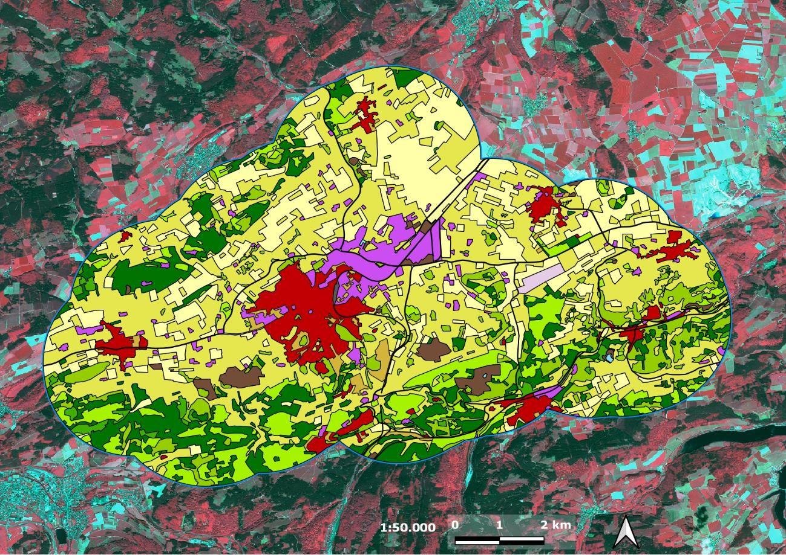{width=437pt}

In the **fourth production phase** (started in 2024) the PA Aol was enlarged. The Area of Interest (Aol) used for the CLMS Protected Areas products is derived from the aggregation of Natura 2000 sites provided by the Member States and complemented by Emerald Network sites and the United Kingdom contribution. Prior to production, the Aol underwent a dedicated refinement process aimed at ensuring geometric consistency and suitability for large-scale land cover and land use mapping. Several issues inherent to the aggregation of protected area datasets, such as overlapping polygons, multipart geometries, isolated features below the Minimum Mapping Unit (MMU) and topological inconsistencies, were identified and addressed. The following examples illustrate some of the most representative cases encountered during the Aol preparation and the actions undertaken to obtain a seamless and coherent area of interest for the CLMS Protected Areas products. A 20 m buffer was applied to the Area of Interest to reduce snapping issues between adjacent polygons and to avoid the generation of isolated artefacts and spikes. This operation contributed to obtaining a more robust and homogeneous spatial framework for the subsequent land cover and land use mapping activities.

Table 4: Overview of N2000 terrestrial sites and area per level of processing and inclusion within PA2021

| Area | 2015 | 2018 |
|----------------------------------|-----------|-----------|
| Sites PA2021 ITT (no UK) | 24.298 | 735.481 |
| Sites PA2021 (w/ UK) | 25.011 | 757.591 |
| Sites PA2021 (AoI fixed) | 25.011 | 821.354 |


**Overlapping polygons (Figures 12).**

Overlapping polygons inherited from the aggregation of different protected area sources were identified during the Aol preparation. These overlaps were reviewed and resolved in order to obtain a seamless and geometrically consistent area of interest suitable for the production workflow.

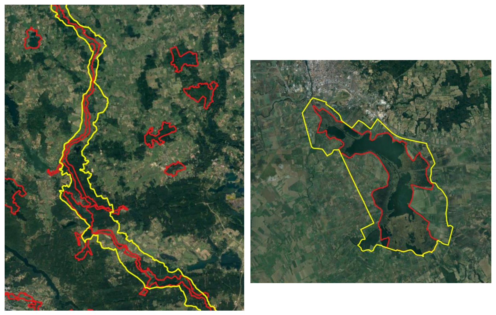{width=435pt}

**Multipart geometries (Figures 13).**

Several protected areas are represented by multipart geometries containing isolated components of different sizes. Particular attention was paid to small isolated polygons and their consistency with the Minimum Mapping Unit (MMU) requirements, ensuring that the final Aol remained coherent while preserving the integrity of the protected sites.

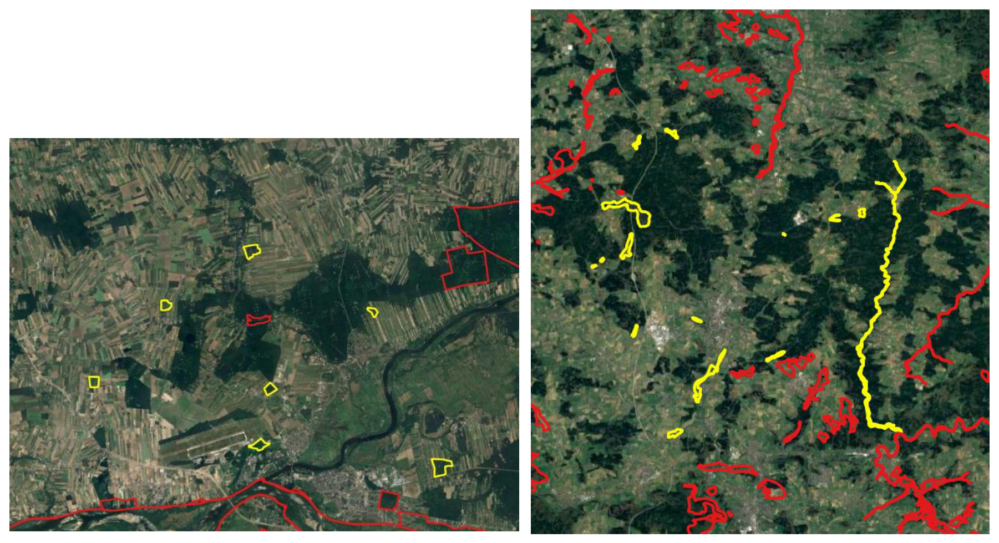{width=432pt}

**Minimum Mapping Unit issues (Figures 14).**

Small, isolated polygons and narrow artefacts below the Minimum Mapping Unit (MMU) and Minimum Mapping Width (MMW) thresholds were identified during the refinement process. Geometric adjustments and buffering operations were applied to avoid spikes and improve topological consistency.

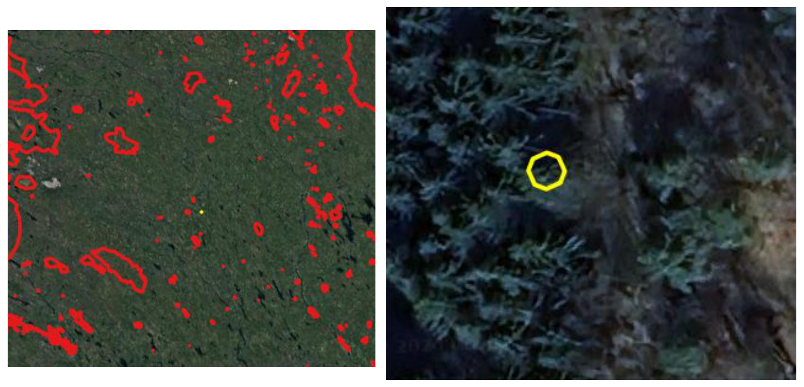{width=428pt}

**Sliver polygons (Figures 15).**

Sliver polygons and narrow artefacts generated by geometric inconsistencies during the aggregation of protected area boundaries were identified throughout the Aol refinement process. Most of these artefacts were automatically corrected through dedicated topological operations based on angle revision and geometry regularization. In a limited number of cases, manual editing was required to preserve the integrity of the original boundaries and ensure a consistent representation of the Area of Interest.

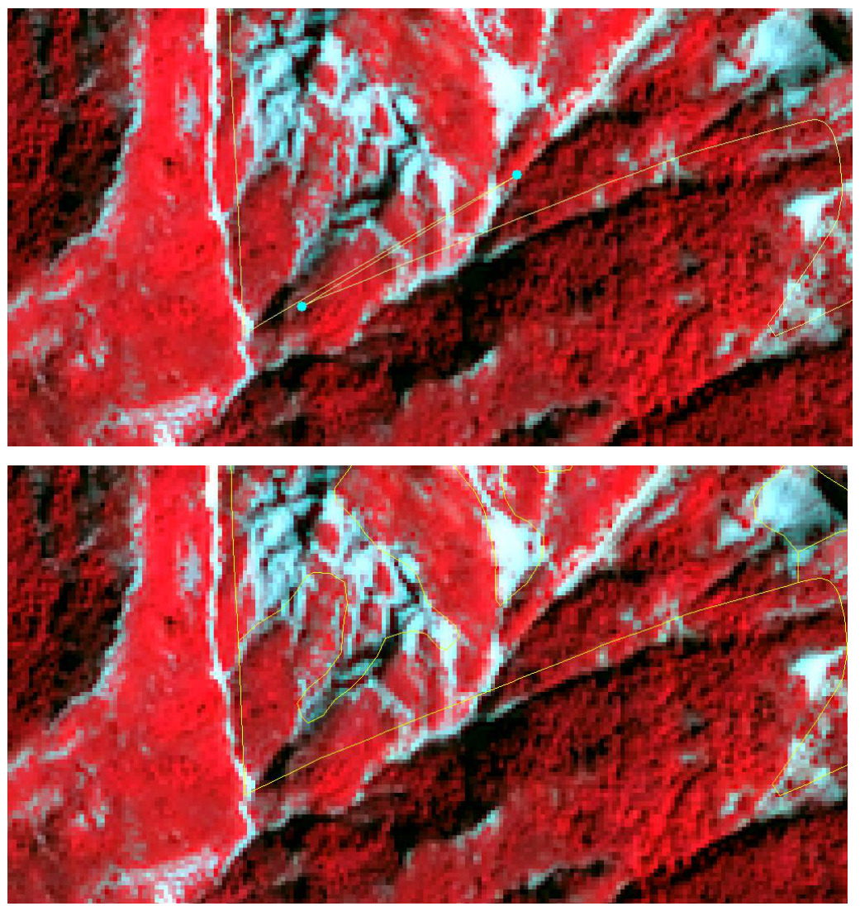

**Bad snapping and boundary consistency**

Misalignments and bad snapping effects between adjacent polygons were detected during the preparation of the Aol. To improve boundary consistency and reduce the occurrence of small gaps, overlaps and isolated artefacts, a 20 m buffer was applied to the Area of Interest. This operation contributed to obtaining a more robust and homogeneous spatial framework for the subsequent land cover and land use mapping activities.

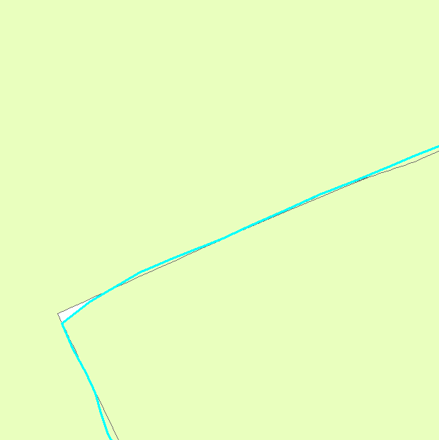{width=206pt}

**CLMS N2K21 status layer: example**

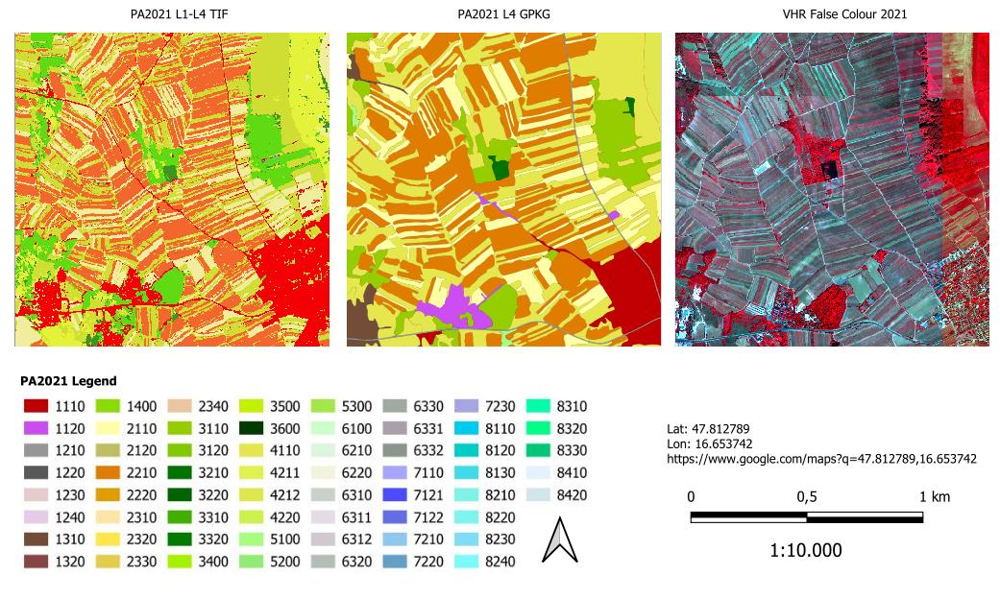{width=433pt}

## Product specifications
Table 5 summarizes the technical specifications of the N2K-PA products.

Table 5: Product overview sheet
```{=html}
<table>
<colgroup>
<col style="width: 13%">
<col style="width: 14%">
<col style="width: 12%">
<col style="width: 12%">
<col style="width: 14%">
<col style="width: 12%">
<col style="width: 23%">
</colgroup>
<thead>
  <tr>
    <th>Specification</th>
    <th>LC/LU status 2018</th>
    <th>LC/LU status 2012 (revised)</th>
    <th>LC/LU status 2006 (revised)</th>
    <th>LC/LU change 2006-2012 (revised)</th>
    <th>LC/LU change 2012-2018</th>
    <th>PA2021 LC/LU status layer</th>
  </tr>
</thead>
<tbody>
  <tr>
    <td>Geographic Coverage</td>
    <td colspan="5">~ 631 820 km² across EU27 and the UK and Switzerland (N2K sites including 2 km buffer); including three Emerald sites in Switzerland</td>
    <td>All the terrestrial N2000 sites with a 20 meter buffer: 25,011 and 821 000 km² across EU27 and the UK and Switzerland emerald sites</td>
  </tr>
  <tr>
    <td>Temporal description<br>(VHR coverage reference dates)</td>
    <td>2018 (± 1 year)</td>
    <td>2012 (± 2 years, due to data availability)</td>
    <td>2006 (± 2 years, due to data availability)</td>
    <td>2006 and 2012</td>
    <td>2012 and 2018</td>
    <td>2021</td>
  </tr>
  <tr>
    <td>Minimum Mapping Unit (MMU)</td>
    <td colspan="6">0.5 ha<sup>1</sup></td>
  </tr>
  <tr>
    <td>Minimum Mapping Width (MMW)</td>
    <td colspan="6">10 m<sup>2</sup></td>
  </tr>
  <tr>
    <td>Nomenclature</td>
    <td colspan="5">CLMS N2K Nomenclature and Mapping Guideline (Issue 1.4)</td>
    <td>CLMS PA Nomenclature and Mapping Guideline (30/04/2026)</td>
  </tr>
  <tr>
    <td>Projection</td>
    <td colspan="6">ETRS89 Lambert Azimuthal Equal Area (LAEA) (European Petroleum Survey Group coordinate reference system codes -EPSG- 3035)</td>
  </tr>
  <tr>
    <td>Delivery format</td>
    <td colspan="6">LC/LU data: Environmental Systems Research Institute -ESRI- file geodatabase and GeoPackage, containing the three status (2006, 2012, 2018) and two change layers (2006-2012, 2012-2018)</td>
  </tr>
  <tr>
    <td>Metadata</td>
    <td colspan="6">INSPIRE compliant following the latest INSPIRE Metadata Implementing Rules and INSPIRE Data Specification on Land Cover</td>
  </tr>
  <tr>
    <td>Ancillary information layer</td>
    <td colspan="5">Parent Scene Identification Layer (PSIL); vector file containing spatial reference information on the satellite images used for producing the LC/LU map (on demand – send email to copernicus@eea.europa.eu</td>
    <td>PSIL and confidence layers)</td>
  </tr>
  <tr>
    <td>Positional accuracy</td>
    <td colspan="6">RMSE (Root Mean Square Error) ≤ 5 meters</td>
  </tr>
  <tr>
    <td>Overall thematic classification accuracy: LC/LU status and change layers</td>
    <td colspan="2">≥ 85% overall accuracy<br>≥ 80% for class specific user and producer accuracies</td>
    <td>≥ 85% overall accuracy</td>
    <td>≥ 85% overall accuracy<br>≥ 80% for class specific user and producer accuracies</td>
    <td>≥ 80% overall accuracy</td>
    <td>≥ 85% overall accuracy<br>≥ 80% for class specific user and producer accuracies</td>
  </tr>
</tbody>
</table>
```

^1^ Some exceptions are allowed for polygons at the product boundary and polygons inside the boundary related to linear networks or urban areas and for change polygons in very specific cases.

^2^ Exceptions of 10m over a distance of up to 100m are allowed to maintain continuity of features with mostly linear nature.

The CLMS N2K-PA products are delivered as polygon vector data for the reference years over the selected sites across Europe. Each product is delivered as a separate data set, following a uniform technical specification. The content of a download package is explained below:

Each download package is a \*.zip file which contains three folders:

*   **DATA** (contains the data files in gdb and geoPackage formats):
    *   LC/LU status map 2006: LC/LU based on the analysis of satellite images from the reference year period 2006.
        *   File name: N2K_2006_3035_v010
    *   LC/LU status map 2012: LC/LU based on the analysis of satellite images from the reference year period 2012.
        *   File name: N2K_2012_3035_v010
    *   LC/LU status map 2018: LC and LU classification based on the analysis of satellite images from the reference year period 2018.
        *   File name: N2K_2018_3035_v010
    *   LC/LU change map 2006-2012: based on the outputs of the 2012 and 2006 status layers.
        *   File name: N2K_Change_2006_2012_3035_v010
    *   LC/LU change map 2012-2018: LC/LU change information based on the comparison of satellite images from the reference year periods 2012 and 2018. The production of this product is the basis for the status map for 2018 as well as for the revision of the previous time steps for 2012 and 2006.
        *   File name: N2K_Change_2012_2018_3035_v010
    *   **LC/LU status map 2021: LC and LU classification based on the analysis of satellite images from the reference year period 2021 for each BIOREGION.**
        *   **File naming convention**: The file naming convention follows a standardized structure that encodes the service name, product type, reference year, delivery unit, biogeographical region, minimum mapping unit, geographical coverage, coordinate reference system, product and release versions, production date and file format. For example, CLMS_PA_LCU_S2021_DU0001_V05ha_EU27_03035_V01_R01_20260216.gpkg corresponds to the Protected Areas LC/LU status layer for 2021 in the Alpine region, delivered in GeoPackage format.
            *   CLMS_PA_LCU_S2021_DU0001_V05ha_EU27_03035_V01_R01_20260216.gpkg.
            *   CLMS_PA_LCU_S2021_DU0001_V05ha_EU27_03035_V01_R01_20260216.gdb.
            
*   **SYMBOLOGY**: Contains symbology files in three formats: sld, lyr and qml.

*   **METADATA**: Contains metadata file in XML format.

All products contain information on the LC/LU class as well as auxiliary information (e.g. on temporal dynamics of the mapped polygon or change related area size exceptions). The attribute information is given per polygon following a standardized attribution scheme (Table 6 and Table 7).

Table 6: Product attribute definition for the table LC_LU (ESRI GDB representation)

| Field | Description | Type | Value(s) | Applicable products |
|-------|-------------|------|----------|---------|
| [OBJECTID] | Dynamic Feature Identifier | Object ID | 0 to 2.147.483.647 | Status, Change |
| [Shape] | Polygon | Geometry | Polygon | Status, Change |
| [AREA_HA] | Area in hectare [ha] | Double | 0.001 to 1.8E308 | Status, Change |
| [UID] | Unique Identifier of the feature geometry, generated as combination of Delivery Unit Code + OBJECTID in the form of “DU_OBJECTID” | String, Length 20 | Starting from 1_1 | Status, Change |
| [CODE_1_21] | Class code of LC/LU Level 1 for LC/LU 2018 | Long, Precision 9 | 1 to 10 | Status, Change |
| [CODE_2_21] | Class code of LC/LU Level 2 for LC/LU 2018 | Long, Precision 9 | 11 to 101 | Status, Change |
| [CODE_3_21] | Class code of LC/LU Level 3 for LC/LU 2018 | Long, Precision 9 | 111 to 1011 | Status, Change |
| [CODE_4_21] | Class code of LC/LU Level 4 for LC/LU 2018 | Long, Precision 9 | 1111 to 10111 | Status, Change |
| [COMMENT_21] | Comment field for additional information for LC/LU 2018 separated by Semicolon | String, Length 254 | Standardized text comments | Status |
| [NODATA_21] | Unclassifiable area due to clouds, shadows, snow, haze or missing data (no satellite data available) | Long, Precision 9 | 0,1 | Status, Change |
| [du_id] | Unique Identifier of Delivery Unit | String, Length 254 | Standardized text comments | Status |
| SHAPE_Length | Polygon perimeter in metres | Double | 0.001 to 1.8E308 | Status, Change |
| SHAPE_Area | Polygon area in m² | Double | 0.001 to 1.8E308 | Status, Change |


Table 7: Product attribute definition for the table LC_LU (GeoPackage .gpkg representation)

| Field | Description | Type | Value(s) | Applicable products |
|-------|-------------|------|----------|---------|
| [OBJECTID] | Dynamic Feature Identifier | Object ID | 0 to 2.147.483.647 | Status, Change |
| [Shape] | Polygon | Geometry | Polygon | Status, Change |
| [AREA_HA] | Area in hectare [ha] | Double | 0.001 to 1.8E308 | Status, Change |
| [UID] | Unique Identifier of the feature geometry, generated as combination of Delivery Unit Code + OBJECTID in the form of “DU_OBJECTID” | String, Length 20 | Starting from 1_1 | Status, Change |
| [CODE_1_21] | Class code of LC/LU Level 1 for LC/LU 2018 | Long, Precision 9 | 1 to 10 | Status, Change |
| [CODE_2_21] | Class code of LC/LU Level 2 for LC/LU 2018 | Long, Precision 9 | 11 to 101 | Status, Change |
| [CODE_3_21] | Class code of LC/LU Level 3 for LC/LU 2018 | Long, Precision 9 | 111 to 1011 | Status, Change |
| [CODE_4_21] | Class code of LC/LU Level 4 for LC/LU 2018 | Long, Precision 9 | 1111 to 10111 | Status, Change |
| [COMMENT_21] | Comment field for additional information for LC/LU 2018 separated by Semicolon | String, Length 254 | Standardized text comments | Status |
| [NODATA_21] | Unclassifiable area due to clouds, shadows, snow, haze or missing data (no satellite data available) | Long, Precision 9 | 0,1 | Status, Change |
| [du_id] | Unique Identifier of Delivery Unit | String, Length 254 | Standardized text comments | Status |
| SHAPE_Length | Polygon perimeter in metres | Double | 0.001 to 1.8E308 | Status, Change |
| SHAPE_Area | Polygon area in m² | Double | 0.001 to 1.8E308 | Status, Change |


The standardized entries for [COMMENT] are separated by a semicolon in increasing order following their “Order No” (Table 8).

Table 8: List of allowed [COMMENT] entries

| Order No | Entry value | Description; Note | Applicable products |
|----------|-------------------------------------|----------------------------------------------------------------------------------------------------------------------|-----------------------------|
| 1 | “Area size exception (at Natura2000 AoI boundary)“ | Polygons < 0.5 ha at outer AoI site boundary, that have an apparent continuation outside the AoI boundary, which is visible on the image data. | Status, Change |
| 2 | “Area size exception (inside Natura2000 AoI boundary)“ | Polygons < 0.5 ha inside AoI site boundary, that are allowed due to nomenclature guideline rules e.g. to represent changes, to ensure continuity of road/rail/river network at intersections of these classes, to mark urban objects confined by roads or railways ≥ 0.25 ha up to < 0.5 ha | Status, Change |
| 3 | “Splitted change” | Changes over several classes. Each change is < 0.5 ha but overall change (=sum of individual change areas) is > 0.5 ha. | Change |
| 4 | “Areas related to change” | Polygons < 0.5 ha with no change but connected to change polygons (same code at a neighbouring polygon in one of the two years) | Status |
| 5 | “Temporal fluctuation of water level” | Different water levels in comparison of image data taken during dry/wet season and conditions. The water level situation of the reference year 2012 should be used for delineation. A flood event is not considered as a “Temporal fluctuation of water level” | Status, Change |
| 6 | “Flooded area” | Used for extraordinary flooding events where non-water land cover features are covered (partly or fully) by water. Comment is applied only in the year of the flooding event. | Status, Change |
| 7 | “Braided River” | For river banks that are crossed by side arms of a river. Only valid for MAES_4 Code 6213 (river banks) | Status, Change |


### CLMS PA Nomenclature
The Nomenclature for the LC/LU dataset is structured into four levels (Code level 1- Code level 4). There are 59 different LC/LU classes (Table 9). The detailed description of each class is given in the PA nomenclature and mapping guideline (AD01). The LC/LU code levels were designed to correspond to the Mapping and Assessment of Ecosystems and their Services (MAES) typology Level 2 (Maes et al., 2013).

Table 9: CLMS PA nomenclature overview (v1.4, dated 30.04.2026)

```{=html}
<table>
<colgroup>
<col style="width: 16.3%">
<col style="width: 21.4%">
<col style="width: 21.4%">
<col style="width: 21.4%">
<col style="width: 15.5%">
<col style="width: 4.0%">
</colgroup>
  <tr>
    <td style="background-color:#DDDDDD">Level 1</td>
    <td style="background-color:#DDDDDD">Level 2</td>
    <td style="background-color:#DDDDDD">Level 3</td>
    <td style="background-color:#DDDDDD">Level 4</td>
    <td style="background-color:#DDDDDD">MAES Level 2</td>
  </tr>
  <tr>
    <td rowspan="9" style="background-color:#FF4040; color:#FFFFFF">1. Urban</td>
    <td rowspan="2" style="background-color:#C00000; color:#FFFFFF">1.1 Urban fabric, industrial, commercial, public, military and private units</td>
    <td style="background-color:#C00000; color:#FFFFFF">1.1.1 Urban fabric (predominantly public and private units)</td>
    <td></td>
    <td rowspan="9">URBAN</td>
  </tr>
  <tr>
    <td style="background-color:#9660EE">1.1.2 Industrial, commercial and military units</td>
    <td></td>
  </tr>
  <tr>
    <td rowspan="4" style="background-color:#83899D">1.2 Transport infrastructure</td>
    <td style="background-color:#83899D">1.2.1 Road networks and associated land</td>
    <td></td>
  </tr>
  <tr>
    <td style="background-color:#404040; color:#FFFFFF">1.2.2 Railways and associated land</td>
    <td></td>
  </tr>
  <tr>
    <td style="background-color:#FFE6DE">1.2.3 Port areas and associated land</td>
    <td></td>
  </tr>
  <tr>
    <td style="background-color:#DF9FC2">1.2.4 Airports and associated land</td>
    <td></td>
  </tr>
  <tr>
    <td rowspan="2" style="background-color:#946200; color:#FFFFFF">1.3 Mineral extraction, dump and construction sites, land without current use</td>
    <td style="background-color:#946200; color:#FFFFFF">1.3.1 Mineral extraction sites, dump and construction sites</td>
    <td></td>
  </tr>
  <tr>
    <td style="background-color:#693700; color:#FFFFFF">1.3.2 Land without current use</td>
    <td></td>
  </tr>
  <tr>
    <td style="background-color:#91D500">1.4 Green urban, sports and leisure facilities</td>
    <td></td>
    <td></td>
  </tr>
  <tr>
    <td rowspan="8" style="background-color:#FFFFA8">2. Cropland</td>
    <td rowspan="2" style="background-color:#FFFFA8">2.1 Arable land</td>
    <td style="background-color:#FFFFA8">2.1.1 Arable irrigated and non-irrigated land</td>
    <td></td>
    <td rowspan="8">CROPLAND</td>
  </tr>
  <tr>
    <td style="background-color:#B8C151">2.1.2 Greenhouses</td>
    <td></td>
  </tr>
  <tr>
    <td rowspan="2" style="background-color:#F0CC80">2.2 Permanent crops</td>
    <td style="background-color:#F38309">2.2.1 Vineyards, fruit trees and berry plantations</td>
    <td></td>
  </tr>
  <tr>
    <td style="background-color:#DF9F00">2.2.2 Olive groves</td>
    <td></td>
  </tr>
  <tr>
    <td rowspan="4" style="background-color:#FFE6A6">2.3 Heterogeneous agricultural area</td>
    <td style="background-color:#FFE6A6">2.3.1 Annual crops associated with permanent crops</td>
    <td></td>
  </tr>
  <tr>
    <td style="background-color:#FFE64D">2.3.2 Complex cultivation patterns</td>
    <td></td>
  </tr>
  <tr>
    <td style="background-color:#E6CC4D">2.3.3 Land principally occupied by agriculture with significant areas of natural vegetation</td>
    <td></td>
  </tr>
  <tr>
    <td style="background-color:#EBC59F">2.3.4 Agro-forestry</td>
    <td></td>
  </tr>
  <tr>
    <td rowspan="9" style="background-color:#007800; color:#FFFFFF">3. Woodland and forest</td>
    <td rowspan="2" style="background-color:#82BC00">3.1 Broadleaved forest</td>
    <td style="background-color:#82BC00">3.1.1 Natural &amp; semi-natural broadleaved forest</td>
    <td></td>
    <td rowspan="9">WOODLAND AND FOREST</td>
  </tr>
  <tr>
    <td style="background-color:#82BC00">3.1.2 Highly artificial broadleaved plantations</td>
    <td></td>
  </tr>
  <tr>
    <td rowspan="2" style="background-color:#007800; color:#FFFFFF">3.2 Coniferous forest</td>
    <td style="background-color:#007800; color:#FFFFFF">3.2.1 Natural &amp; semi-natural coniferous forest</td>
    <td></td>
  </tr>
  <tr>
    <td style="background-color:#007800; color:#FFFFFF">3.2.2 Highly artificial coniferous plantations</td>
    <td></td>
  </tr>
  <tr>
    <td rowspan="2" style="background-color:#419F00">3.3 Mixed forest</td>
    <td style="background-color:#419F00">3.3.1 Natural &amp; semi-natural mixed forest</td>
    <td></td>
  </tr>
  <tr>
    <td style="background-color:#419F00">3.3.2 Highly artificial mixed plantations</td>
    <td></td>
  </tr>
  <tr>
    <td style="background-color:#A9EF00">3.4 Transitional woodland and scrub</td>
    <td></td>
    <td></td>
  </tr>
  <tr>
    <td style="background-color:#C3F000">3.5 Lines of trees and scrub</td>
    <td></td>
    <td></td>
  </tr>
  <tr>
    <td style="background-color:#2B342B; color:#FFFFFF">3.6 Damaged forest</td>
    <td></td>
    <td></td>
  </tr>
  <tr>
    <td rowspan="4" style="background-color:#E6E64D">4. Grassland</td>
    <td style="background-color:#E6E64D">4.1 Managed grassland</td>
    <td></td>
    <td></td>
    <td rowspan="4">GRASSLAND</td>
  </tr>
  <tr>
    <td rowspan="3" style="background-color:#DFF04D">4.2 Natural & semi-natural grassland</td>
    <td rowspan="2" style="background-color:#DFF04D">4.2.1 Semi-natural grassland</td>
    <td style="background-color:#DFF04D">4.2.1.1 Semi-natural grassland with woody plants (C.C.D. ≥ 30 %)</td>
  </tr>
  <tr>
    <td style="background-color:#DFF04D">4.2.1.2 Semi-natural grassland without woody plants (C.C.D. < 30%)</td>
  </tr>
  <tr>
    <td style="background-color:#CCF04D">4.2.2 Alpine and sub-alpine natural grassland</td>
    <td></td>
  </tr>
  <tr>
    <td rowspan="3" style="background-color:#CCF04D">5. Heathland and scrub</td>
    <td style="background-color:#A6FF80">5.1 Heathland and moorland</td>
    <td></td>
    <td></td>
    <td rowspan="3">HEATHLAND AND SCRUB</td>
  </tr>
  <tr>
    <td style="background-color:#9FED6A">5.2 Alpine scrub land</td>
    <td></td>
    <td></td>
  </tr>
  <tr>
    <td style="background-color:#A9EB5C">5.3 Sclerophyllous scrubs</td>
    <td></td>
    <td></td>
  </tr>
  <tr>
    <td rowspan="8" style="background-color:#CCFFD5">6. Open spaces with little or no vegetation</td>
    <td style="background-color:#CCFFD5">6.1 Sparsely vegetated areas</td>
    <td></td>
    <td></td>
    <td rowspan="8">SPARSELY VEGETATED</td>
  </tr>
  <tr>
    <td rowspan="2" style="background-color:#DFF5DC">6.2 Beaches, dunes, river banks</td>
    <td style="background-color:#DFF5DC">6.2.1 Beaches and dunes</td>
    <td></td>
  </tr>
  <tr>
    <td style="background-color:#DFDFDC">6.2.2 River banks</td>
    <td></td>
  </tr>
  <tr>
    <td rowspan="5" style="background-color:#B4BCB4">6.3 Bare rocks, burnt areas, glaciers and perpetual snow</td>
    <td rowspan="2" style="background-color:#B4BCB4">6.3.1 Bare rocks, outcrops, cliffs and scree</td>
    <td style="background-color:#B4BCB4">6.3.1.1 Bare rocks, outcrops, cliffs</td>
  </tr>
  <tr>
    <td style="background-color:#B4BCB4">6.3.1.2 Scree</td>
  </tr>
  <tr>
    <td style="background-color:#9FAA9F">6.3.2 Burnt areas (except burnt forest)</td>
    <td></td>
  </tr>
  <tr>
    <td rowspan="2" style="background-color:#8A948A">6.3.3 Glaciers and perpetual snow</td>
    <td style="background-color:#8A948A">6.3.3.1 Glaciers</td>
  </tr>
  <tr>
    <td style="background-color:#8A948A">6.3.3.2 Perpetual snow</td>
  </tr>
  <tr>
    <td rowspan="6" style="background-color:#A6A6FB">7. Wetland</td>
    <td rowspan="3" style="background-color:#A6A6FB">7.1 Inland wetlands</td>
    <td style="background-color:#A6A6FB">7.1.1 Inland marshes</td>
    <td></td>
    <td rowspan="3">WETLAND</td>
  </tr>
  <tr>
    <td rowspan="2" style="background-color:#5D5FF8; color:#FFFFFF">7.1.2 Peat bogs</td>
    <td style="background-color:#5D5FF8; color:#FFFFFF">7.1.2.1 Exploited peat bogs</td>
  </tr>
  <tr>
    <td style="background-color:#4648F8; color:#FFFFFF">7.1.2.2 Unexploited peat bogs</td>
  </tr>
  <tr>
    <td rowspan="3" style="background-color:#91C6EE">7.2 Coastal wetlands</td>
    <td style="background-color:#91C6EE">7.2.1 Salt marshes</td>
    <td></td>
    <td rowspan="3">MARINE INLETS AND TRANSITIONAL WATERS</td>
  </tr>
  <tr>
    <td style="background-color:#858FA7">7.2.2 Salines</td>
    <td></td>
  </tr>
  <tr>
    <td style="background-color:#A0A1E1">7.2.3 Intertidal flats</td>
    <td></td>
  </tr>
  <tr>
    <td rowspan="12" style="background-color:#00F5DB">8. Water</td>
    <td rowspan="3" style="background-color:#00EFDD">8.1 Water courses</td>
    <td style="background-color:#00EFDD">8.1.1 Natural & semi-natural water courses</td>
    <td></td>
    <td rowspan="7">RIVERS AND LAKES</td>
  </tr>
  <tr>
    <td style="background-color:#00F4CF">8.1.2 Highly modified water courses and canals</td>
    <td></td>
  </tr>
  <tr>
    <td style="background-color:#79EBEE">8.1.3 Seasonally connected water courses (oxbows)</td>
    <td></td>
  </tr>
  <tr>
    <td rowspan="4" style="background-color:#82EEEE">8.2 Lakes and reservoirs</td>
    <td style="background-color:#82EEEE">8.2.1 Natural lakes</td>
    <td></td>
  </tr>
  <tr>
    <td style="background-color:#78E6E6">8.2.2 Reservoirs</td>
    <td></td>
  </tr>
  <tr>
    <td style="background-color:#6CDCDC">8.2.3 Aquaculture ponds</td>
    <td></td>
  </tr>
  <tr>
    <td style="background-color:#62D2D2">8.2.4 Standing water bodies of extractive industrial sites</td>
    <td></td>
  </tr>
  <tr>
    <td rowspan="3" style="background-color:#00FFA6">8.3 Transitional waters</td>
    <td style="background-color:#00FFA6">8.3.1 Lagoons</td>
    <td></td>
    <td rowspan="3">MARINE INLETS AND TRANSITIONAL WATERS</td>
  </tr>
  <tr>
    <td style="background-color:#00DF85">8.3.2 Estuaries</td>
    <td></td>
  </tr>
  <tr>
    <td style="background-color:#00C677">8.3.3 Marine inlets and fjords</td>
    <td></td>
  </tr>
  <tr>
    <td rowspan="2" style="background-color:#E6F5F3">8.4 Sea and ocean</td>
    <td style="background-color:#E6F5F3">8.4.1 Open sea</td>
    <td></td>
    <td>OPEN OCEAN</td>
  </tr>
  <tr>
    <td style="background-color:#D2E6EB">8.4.2 Coastal waters</td>
    <td></td>
    <td>COASTAL</td>
  </tr>
</table>
```




# Production methodology and workflow overview
The technical methodology underlying the CLMS Protected Areas products is described in detail in the **Algorithm Theoretical Basis Document (ATBD)** developed for the PA2021 production cycle (CLMS, 2026b). The ATBD provides a comprehensive description of the input datasets, processing chain, classification methodology, nomenclature implementation and post-processing procedures used for the generation of the products. The present section provides only a concise overview of the main methodological principles and workflow steps relevant to the users of the CLMS Protected Areas products. Detailed technical specifications and algorithmic aspects are available in the associated ATBD documentation. The CLMS N2K production is based on a **semiautomatic approach** (Figure 18).

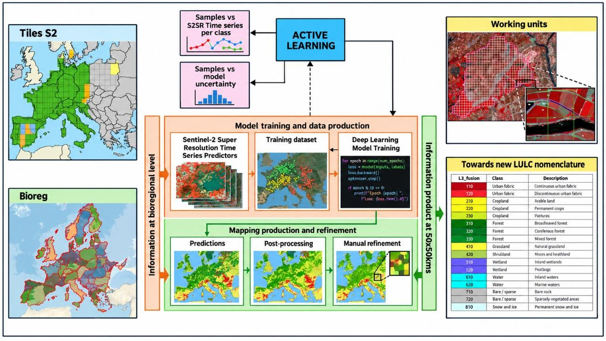{width=433pt}

## Data pre-processing
The production of the CLMS Protected Areas products relies primarily on multi-temporal Sentinel-2 Level-2A imagery. Cloud-free seasonal mosaics are generated for each biogeographical region in order to maximize the spectral and temporal information available for land cover and land use characterization. To enhance the spatial detail while preserving the spectral consistency of Sentinel-2 observations, the imagery is processed using COTESA's super-resolution approach, resulting in **super-resolved Sentinel-2 (S2SR) time series**. Multi-temporal coregistration and quality control procedures are subsequently applied to ensure geometric consistency and to remove suboptimal observations affected by clouds, haze, snow or other artefacts.

In addition to Sentinel-2 imagery, several CLMS products and ancillary datasets are integrated into the workflow to support classification and improve thematic consistency. These include the previous Natura 2000 layers, Coastal Zones, Riparian Zones, High Resolution Layers, CLCPlus Backbone, EU-Hydro, the European Wetland Map and OpenStreetMap data, among others. These complementary sources provide thematic support for specific classes and contribute to the harmonization with other Copernicus Land Monitoring Service products.

The ESA VHR_IMAGE_2021 collection consists of cloud-free orthorectified mosaics derived from multiple commercial Very High Resolution satellite missions acquired around the 2021 reference period. The collection provides multispectral information in the visible and near-infrared bands at spatial resolutions ranging from 1 to 4 m. Within the CLMS Protected Areas workflow, VHR imagery is primarily used as a reference source for manual refinement and quality control activities. Additional CLMS products and ancillary datasets are integrated into the production workflow to improve thematic consistency and support the land cover and land use analysis.

The satellite data provided via these ESA data sources include different sensor types:

*   Deimos-02
*   Geosat-02
*   Vision-01
*   SPOT-6
*   GeoEye 01
*   SPOT-7
*   Superview.1
*   SuperView-1
*   Kompsat 03/04
*   TripleSat
*   Pleiades 1A
*   WorldView 2
*   Pleiades 1B
*   WorldView 3

Additional ancillary information and online image services are used whenever necessary to support the interpretation process and resolve ambiguous situations during manual refinement. The combination of super-resolved Sentinel-2 time series, CLMS reference datasets and VHR imagery enable the generation of harmonized, high-resolution land cover and land use products for all terrestrial Natura 2000 sites.

## Interpretation and classification
The Interpretation and Classification procedures follow the mapping rules and principles as stated in the CLMS N2K Nomenclature and Mapping Guideline (AD01; Issue 1.4, 30 April 2026; CLMS, 2026a). This documentation refers specifically to object delineation; MMU and MMW; feature extraction priority rules; water level mapping rules; handling of geometric inconsistencies between the reference years; inclusion of additional data sources and the application of standardized data attributes. Feature delineation is applied at a 1:10.000 mapping scale.

**Mapping LC/LU Status**
The LC/LU status is generated through manual refinement (by using ESA_VHR_2021) on an automatic pipeline that heavily relies on the super-resolved Sentinel-2 temporal series and Copernicus curated data feeding Deep Learning models, as well as advanced post-processing techniques. The type of LC/LU is classified according to the CLMS N2K Nomenclature and Mapping Guideline document (AD01). A minimum mapping unit (MMU) of ≥ 0.5 ha for all objects applies. A minimum width (MMW) of ≥ 10 m is defined. MMU exceptions are allowed for:

*   Objects located at a CLMS N2K product border: If an object is cut at a border, the feature is mapped, if the whole object (inside and outside the border) would amount to ≥ 0.5 ha. However, the MMU of those divided features lying inside the site shall have a MMU of at least ≥ 0.1 ha. Smaller objects will be generalized.
*   Linear features (roads, railways, rivers) that are split in two or more polygons by other linear elements (e.g. the road/railway network) will be mapped even if the resulting segments are smaller than the MMU to preserve the network. However, features < 0.1 ha will be generalized.
*   Urban objects which are confined by roads or railways. Features < 0.25 ha will be generalized.

MMW exceptions are allowed:

*   To maintain continuity of features with mostly linear nature — Road networks and associated land (1.2.1), Railways and associated land (1.2.2), Beaches and dunes (6.2.1), Riverbanks (6.2.2), Natural & semi-natural water courses (8.1.1), and highly modified water courses and canals (8.1.2) — the MMW may fall below the limit of 10 m over a distance of up to 100 m.

## Quality assessment
The quality assessment methodology and the quality control procedures implemented for the CLMS Protected Areas products are described in detail in the Protected Areas LC/LU 2021 status product - Final Validation Report (Hugé & Pennec, 2026). The present section provides only an overview of the approach followed for quality assurance and thematic validation, together with the main accuracy requirements and key validation results. Detailed descriptions of the validation methodology, sampling design, statistical analysis and complete accuracy assessment results are available in the dedicated quality assessment documentation.

### Internal thematic validation
For each Protected Areas (PA) LC/LU product, a thematic validation is performed to assess the thematic accuracy of the status and change layers. The assessment is based on a scientifically and statistically sound sampling scheme and independent interpretation procedures.

The following accuracy requirements apply to the products:

*   PA LC/LU status layers 2021 and 2024: ≥ 85% overall accuracy and ≥ 80% for class-specific producer's and user's accuracy.
*   PA LC/LU change layer 2021–2024: ≥ 85% overall accuracy and ≥ 80% for class-specific producer's and user's accuracies.

#### Sampling Design
The thematic accuracy assessment is based on a random systematic and stratified sampling design, ensuring that all areas within the product extent have a known and non-zero probability of being selected. The validation is performed at Level 1 of the nomenclature, which comprises the eight major land cover and land use classes defined for the Protected Areas products.

The sampling approach combines randomization and stratification principles in order to provide statistically robust estimates of overall and class-specific accuracies at pan-European level. Stratification is used to ensure a balanced representation of the different Level 1 classes and to improve the efficiency of the accuracy estimates, particularly for classes occupying relatively small proportions of the total area.

The sampling framework is based on the LUCAS (Land Use/Cover Area Frame Statistical Survey) grid, which provides a harmonised and spatially distributed reference across Europe. A replicate and sub-replicate strategy is adopted to guarantee a homogeneous spatial distribution of samples over the entire area of interest and to avoid concentration of observations in specific regions. Sample allocation is designed to ensure adequate representation of all thematic classes while maintaining statistical rigour and geographical consistency.

The resulting sample set provides sufficient coverage of the Protected Areas domain and supports the derivation of unbiased estimates of overall accuracy as well as class-specific producer's and user's accuracies. The methodology follows internationally recognised recommendations for thematic accuracy assessment and allows the quality of the products to be evaluated consistently at the pan-European scale.

#### Response Design
All sample units are independently interpreted by experienced operators who are not involved in the production process. The interpretation is based on Very High Resolution (VHR) imagery and ancillary reference data and follows the applicable nomenclature and mapping guidelines.

The response design consists of a two-stage process:

*   An initial blind interpretation, during which the validation team has no knowledge of the thematic class assigned in the product. Product polygons are nevertheless provided to account for boundary effects and geometric discrepancies.
*   A plausibility analysis applied to all sample units showing disagreement with the production data, allowing ambiguous situations to be reviewed and ensuring consistency of the assessment.

#### Validation results
The thematic accuracy indicators are derived from weighted confusion matrices and include overall accuracy, producer's accuracy, user's accuracy and F-score.

For the Protected Areas LC/LU 2021 status layer, the overall thematic accuracy reaches 89.63% ± 0.30%, thus fulfilling the target overall accuracy requirement of 85%. Most Level 1 classes satisfy the target values of 80% for producer's and user's accuracies. Detailed class-specific results are documented in the corresponding validation reports.

Full details on the validation methodology, sampling design, confusion matrices, producer's and user's accuracies, confidence intervals and class-specific results are provided in the **Final Validation Report** (Hugé & Pennec, 2026).

Table 10: Number of weighted points per class, as well as CI, omission, producer and user accuracy. Also, overall accuracy is shown

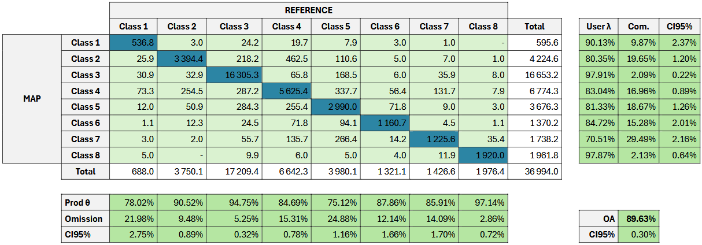{width=451pt}

C1–C8 are the Level 1 class codes (class names are given in Table 11). Overall accuracy is 89.63% (CI95% ± 0.30%).

Table 11: Validation statistics (producer and user accuracy, CI95% and F-score per class at L1)

| Class code | Class name | Prod. accuracy | CI95% | User accuracy | CI95% | F-score |
|----|------------|------|------|------|------|------|
| 1 | Urban | 78.02% | 2.75% | 90.13% | 2.37% | 0.84 |
| 2 | Cropland | 90.52% | 0.89% | 80.35% | 1.20% | 0.85 |
| 3 | Woodland and forest | 94.75% | 0.32% | 97.91% | 0.22% | 0.96 |
| 4 | Grassland | 84.69% | 0.78% | 83.04% | 0.89% | 0.84 |
| 5 | Heathland and scrub | 75.12% | 1.16% | 81.33% | 1.26% | 0.78 |
| 6 | Open spaces with little or no vegetation | 87.86% | 1.66% | 84.72% | 2.01% | 0.86 |
| 7 | Wetland | 85.91% | 1.70% | 70.51% | 2.16% | 0.77 |
| 8 | Water | 97.14% | 0.72% | 97.87% | 0.64% | 0.98 |

### Quality Assurance (QA) and Quality Control (QC) measures
All CLMS Protected Areas products are produced by service providers operating under ISO 9001:2015 certified quality management systems. Quality assurance and quality control procedures are implemented throughout the production workflow to ensure that the products comply with the technical specifications and quality requirements defined for the service.

Continuous quality checks are carried out during data preparation, image interpretation, mapping and post-processing stages. These controls address data integrity and readability, thematic and geometric consistency, logical and topological consistency, attribute coding, completeness of the geographical coverage, metadata completeness and compliance with the Infrastructure for Spatial Information in the European Community (INSPIRE) implementing rules and the EIONET Action Group on Land Monitoring in Europe (EAGLE) data model. Additional checks are performed to verify the quality and suitability of the Earth Observation input data, including radiometric quality and the presence of clouds, haze, shadows, snow or other data gaps.

Besides the internal QA/QC procedures performed by the production teams, the products are subject to an independent thematic validation process based on statistically sound sampling and expert image interpretation. Validation activities are carried out separately from production and provide quantitative estimates of overall producer's and user's accuracies.

Finally, all CLMS Protected Areas products undergo a final quality control and approval process using the [EEA Copernicus Quality Tools](https://github.com/eea/copernicus_quality_tools), a web-based platform developed to support the quality assessment and acceptance of geospatial products submitted to the European Environment Agency.

### External independent validation
The objective of the external independent validation is to provide quantitative information on the thematic quality of the CLMS Protected Areas products and to assess their compliance with the target accuracy requirements.

The external validation process is based on independent reference information and is performed separately from the production activities to ensure an objective assessment of the datasets. Reference data should be as close as possible in time to the imagery used to produce the products and must be fully independent from the information used during the mapping process. Likewise, the experts involved in the validation activities are independent from the production teams.

Within the CLMS Protected Areas framework, external validation refers to thematic validation. At the time of writing this document, the external independent validation has not yet been performed. The corresponding methodology and results will be documented in dedicated validation reports once available.



# Terms of use and product technical support

## Terms of use
The product(s) described in this document is/are created in the frame of the Copernicus programme of the European Union by the European Environment Agency (product custodian) and is/are owned by the European Union. The product(s) can be used following Copernicus full free and open data policy, which allows the use of the product(s) also for any commercial purpose. Derived products created by end users from the product(s) described in this document are owned by the end users, who have all intellectual rights to the derived products.

## Citation
In cases of re-dissemination of the product(s) described in this document or when the product(s) is/are used to create a derived product it is required to provide a reference to the source. A template is provided below:

"© European Union, Copernicus Land Monitoring Service 2026, European Environment Agency (ΕΕΑ)"

## Product technical support
Product technical support is provided by the product custodian through Copernicus Land Monitoring Service helpdesk at copernicus@eea.europa.eu. Product technical support doesn't include software specific user support or general GIS or remote sensing support.



# List of abbreviations and acronyms

| Abbreviation | Meaning |
|---|---------|
| AD | Applicable Document |
| AoI | Area of Interest |
| ATBD | Algorithm Theoretical Basis Document |
| CLC | CORINE Land Cover |
| CLMS | Copernicus Land Monitoring Service |
| CZ | Coastal Zones |
| DB | Database |
| DG ENV | Directorate-General for Environment |
| EAGLE | EIONET Action Group on Land Monitoring in Europe |
| EC | European Commission |
| EEA | European Environment Agency |
| EPSG | European Petroleum Survey Group coordinate reference system codes |
| ESRI | Environmental Systems Research Institute |
| EU | European Union |
| EU27 | European Union 27 Member States |
| GIO | GMES Initial Operations |
| GIS | Geographic Information System |
| GMES | Global Monitoring for Environment and Security |
| GPKG | GeoPackage |
| INSPIRE | Infrastructure for Spatial Information in the European Community |
| KCEO | Knowledge Centre on Earth Observation |
| LC/LU | Land Cover / Land Use |
| MAES | Mapping and Assessment of Ecosystems and their Services |
| MMU | Minimum Mapping Unit |
| MMW | Minimum Mapping Width |
| N2K | Natura 2000 |
| N2K18 | Natura 2000 2018 |
| N2000 | Natura 2000 |
| PA | Protected Areas |
| PSIL | Parent Scene Identification Layer |
| QA | Quality Assurance |
| QC | Quality Control |
| RMSE | Root Mean Square Error |
| RZ | Riparian Zones |
| S2SR | Super-resolved Sentinel-2 |
| VHR | Very High Resolution |



# References

Camia, A., Dowell, M., & Vancutsem, C. (2024). Earth Observation for Biodiversity. Gliottone, I.,
& Bertoglio, C. (Eds.). European Commission, Joint Research Centre, Ispra. JRC135083.

Copernicus Land Monitoring Service (CLMS). (2026). CLMS Protected Areas Nomenclature and
Mapping Guideline, Issue 1.4, 30 April 2026. European Environment Agency. Unpublished
project document.

Copernicus Land Monitoring Service (CLMS). (2026). Copernicus Land Monitoring Service –
Priority Area Monitoring: – Protected Areas Status 2021: Algorithm Theoretical Basis Document
(ATBD), Version 2.1. European Environment Agency.

European Commission. (2019). Commission Staff Working Document: Expression of User Needs
for the Copernicus Programme. SWD(2019) 394 final. European Commission.

European Commission. (2020). EU Biodiversity Strategy for 2030: Bringing nature back into our
lives. COM(2020) 380 final. European Commission.

Maes, J., Teller, A., & Erhard, M. (Eds.). (2013). Mapping and Assessment of Ecosystems and their
Services: An analytical framework for ecosystem assessments under Action 5 of the EU
Biodiversity Strategy to 2020. Publications Office of the European Union. JRC81328.

Hugé, J., & Pennec, A. (2026). Protected Areas LC/LU 2021 status product – Final Validation
Report, Version 2.0. Copernicus Land Monitoring Services: Priority Area Monitoring – Protected
Areas 2021 and 2024. Service contract EEA/DIS/R0/23/009. European Environment Agency.
Unpublished project document.
