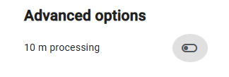

# CLC+ Core User Manual Annex
European Environment Agency (EEA)
2026-09-28

- [1 Admin User
  only](#admin-user-only)
  - [1.1
    Organisations](#organisations)
  - [1.2 Users](#users)
    - [1.2.1 User
      Profile](#user-profile)
    - [1.2.2 User Profile
      View](#user-profile-view)
    - [1.2.3 Edit User
      Profile](#edit-user-profile)
  - [1.3 Add / upload new EAGLE
    Ontology](#add--upload-new-eagle-ontology)
  - [1.4 Approval EAGLE
    barcoding](#approval-eagle-barcoding)
  - [1.5 10m processing toggle
    button](#10m-processing-toggle-button)
    - [1.5.1 Turn off the 10m
      processing toggle
      button](#turn-off-the-10m-processing-toggle-button)
    - [1.5.2 10m functionality
      deactivated in the
      catalogue](#10m-functionality-deactivated-in-the-catalogue)
    - [1.5.3 10m functionality
      deactivated in Add
      Ingestion/Extraction](#10m-functionality-deactivated-in-add-ingestionextraction)
    - [1.5.4 ](#section)
- [2 List of
  abbreviations](#list-of-abbreviations)

Date: 2026-09-28

Doc. Version : Issue 5.0

Content ID: /

**Document Control Information**

| Document Title | CLC+ Core User Guideline |
|----|----|
| Project Title | Operational maintenance of the CLCplus Core platform and infrastructure |
| Document Author | Xabier Diego, Manuel Martínez, Arantza Echevarria |
| Project Owner | Massimiliano Rossi (EEA) |
| Project Manager | Massimiliano Rossi (EEA) |
| Document Code | / |
| Document Version | Issue 5.0 |
| Distribution |  |
| Date | 2026-09-28 |

**Document Approver(s) and Reviewer(s):**

| Name                | Role     | Action          | Date       |
|---------------------|----------|-----------------|------------|
| Tim Wiltzius (CLF)  | Reviewer | Document review | 2023-12-20 |
| Johannes Vass (CLF) | Reviewer | Document review |            |

**Document history**

| Revision | Date | Created by | Short description of changes |
|----|----|----|----|
| 1.0 | 2022-04-08 | CLC+ Core consortium (CLF, GV, GAF) | Initial document creation |
| 2.0 | 2022-06-10 | CLC+ Core consortium (CLF, GV, GAF) | Restructure of entire document, extension of Extraction chapter and Admin User section |
| 3.0 | 2023-06-06 | CLC+ Core consortium (CLF, GV, GAF) | Adaption of rule 3 in the current version of the CLC+ Core system |
| 4.0 | 2023-12-22 | CLC+ Core consortium (CLF, GV, GAF) | Update of the entire document with all newly implemented features and improvements of the system (within SC8) |
| 5.0 | 2026-09-28 | Bilbomática, an Altia company | Update with the new 10m resolution feature |

**Applicable Documents (AD)**

| **ID** | **Document Name / Content** |
|----|----|
| AD01 | Tender Specifications – EEA/DIS/R0/20/019 – Copernicus Land Monitoring Service – Production of the CLC+ Core and Provision of Complementary Consultancy Services |
| AD02 | Consortium’s Technical Proposal – in response to Call for tenders EEA/DIS/R0/20/019 – CLC+CORE Technical Proposal - v2.0 |
| AD03 | Specific Contract No 3436/R0-COPERNICUS/EEA.58286 |
| AD04 | Minutes of the KOM (CLC+Core_KOM_Minutes.docx) |
| AD05 | PM1 - Project Management and Governance Plan (CLC+Core_Deliverable_PM1_Project_Management_Plan_V1.0.pdf) |
| AD06 | Implementation of CLC+ based on the EAGLE concept –Additional support for further development of CLC+  databases (CLC+ and CLC+ instances, namely CLC+ LULUCF instance and CLC+ Legacy instance) - Task 4: From CLC+ Core to CLC+ Legacy - 3436/R0-Copernicus/EEA.57755 |
| AD07 | PM2 - 1st Project Management and Status Report (CLC+Core_Deliverable_PM2_1st-Project-Management-Status-Report_V1.0.pdf) |
| AD08 | CLC+ Core Decision Log_V1.4 (CLC+Core_Decision_log_V1.4.pdf) |
| AD09 | D1 - Software Design (CLC+Core_D1_Software \_Design_V1.0.pdf) |
| AD10 | D3.2.1 - Demonstration and documentation of ingested CLMS datasets, under this Service Contract (CLC+Core_Deliverable_D3.2.1_Demonstration-and-documentation-of-ingested-CLMS-datasets_V01.pdf) |
| AD11 | D3.1 - Documentation of deployment of CLC+ Core products to DIAS – cloud service (CLC+Core_Deliverable_D3.1_Documentation of deployment of CLC+ Core products to DIAS_V1.0.pdf) |
| AD12 | LULUCF_classes_simplified_EAGLE_query_rules_20210325.xlsx (Provided by EAGLE Group) |
| AD13 | Specific contract no 3506_R0-COPERNCA_EEA.59433 |

# Admin User only

In this section information is given which is relevant for **Admin Users
only**. This mainly concerns the categories Organisations and Users,
where the Admin User has additional rights compared to a normal System
User. An important task given to the admin user is the possibility to
upload a new EAGLE ontology into the system.

## Organisations

This navigation menu tab provides an overview of the registered
**Organisations** of the CLC+ Core system.

Organisations are taken over by default from EIONET on your first login
to CLC+ Core. Organisations play an important role when you define the
visibility of your Ingestion or Extraction for publishing it. The
visibility can be limited to users from your organisations only or for
the country of the selected Organisation. Further, the Admin User has
rights to add or remove Organisations (see [Figure
6‑1](#_Ref153959302)).

As an **Admin User** your account has certain authorizations, i.e. you
are able to add new Organisations.

Search function, to **search for an organisation** within the system.

This table presents a list of four organisations managed within a CLC+
(next-generation CORINE Land Cover) Core administration interface. The
table includes columns for “EIONET ID”, “Name”, “E-Mail”, “URL”,
“Country”, and “Status”.

| EIONET ID | Name | E-Mail | URL | Country | Status |
|----|----|----|----|----|----|
| \- | CLC (CORINE Land Cover) |  |  |  | ACTIVE |
| at_cloudflight | Cloudflight |  | https://www.cloudflight.io/ | Austria/Österreich | ACTIVE |
| eu_eea | European Environment Agency |  | http://www.eea.europa.eu/ |  | ACTIVE |
| de_gaf | GAF AG |  | https://www.gaf.de/ | Germany/Deutschland | ACTIVE |

All four listed organisations are marked as ‘ACTIVE’. The table
indicates that 4 of 4 items are displayed, with a setting to show 10
items per page. Above the table, a “Search” bar and an “ADD
ORGANISATION” button are visible. The top navigation bar includes
options for “Data Catalogue”, “EAGLE Ontology”, “About EAGLE”,
“Organisations”, and “Users”, along with “CLC+ Core User Admin/Support”
on the right.

**Figure 6‑1: Menu item –
Organisations**

## Users

This navigation menu tab provides an overview of the registered User of
the CLC+ Core system.

Users are taken over by default from EIONET on your first login to CLC+
Core. Depending on your role assigned, you have more or less rights. The
Admin User has rights to add or remove Users from the system or change
their status. To open your Profile, click on your name (see [Figure
6‑2](#_Ref153959323)). Now you will be forwarded to the Profile view
(section 1.5.1 in User Manual).

As an Admin User your account has certain authorizations, i.e. you are
able to add new Users.

Further, you have the possibility to **search for a User.**

The table presents a list of 7 registered users in the Copernicus Land
Monitoring Service (CLMS) CLC+ Core system, displayed within a user
interface for admin users. The table includes a search function and an
“ADD USER” button.

| EIONET Username | Last name | First name | Organisation/s | Email | Roles | Status |
|----|----|----|----|----|----|----|
| clccore | CLC+ Core | User Admin/Support | CLC, European Environment Agency (EEA) | thomas.mathis@cloudflight.io | EAGLE maintainer / Approver, EIONET / CLC+ Core user | ACTIVE |
| hochpmat | Hochpochler | Matthias | Cloudflight | \- | User Administrator / Support | ACTIVE |
| jaffrdav | Jaffry | David | Cloudflight | \- | Database Administrator, EAGLE administrator | ACTIVE |
| kurzmmar | Kurmann | Markus | Cloudflight | \- | \- | ACTIVE |
| lindmame | Lindmayer | Amelie | GAF AG | amelie.lindmayer@gaf.de | User Administrator / Support | ACTIVE |
| mathitho | Mathis | Thomas | Cloudflight | \- | \- | ACTIVE |
| rennetho | Renner | Thomas | GAF AG | thomas.renner@gaf.de | \- | ACTIVE |

The table shows 7 entries out of 7, with “Items per page: 10” selected
in the pagination controls. All listed users have an “ACTIVE” status.
Organisations include the European Environment Agency (EEA),
Cloudflight, and GAF AG. User roles vary, including “EAGLE maintainer /
Approver, EIONET / CLC+ Core user”, “User Administrator / Support”, and
“Database Administrator, EAGLE administrator”.

**Figure 6‑2: Menu item –
Users.**

### User Profile

To open the **User Profile** you can either click on the User Profile
Icon in the Header, which opens a context menu with the actions ‘My
Profile’ and ‘Logout’ ([Figure 6‑3](#_Ref153959344)) or in the Users tab
by clicking on your name ([Figure 6‑3](#_Ref153959344)). You will then
be forwarded to the Profile view.

This image is a screenshot of the Copernicus Land Monitoring Service
(CLMS) CLC+ Core system’s Data Catalogue interface. The top navigation
bar displays tabs for “Data Catalogue”, “EAGLE Ontology”, “About EAGLE”,
“Organisations”, and “Users”. On the far right, a notification bell icon
is visible next to “CLC+ Core User Admin/Support”, which has an open
dropdown menu showing “My Profile”, “Version:”, and “Logout”.

The main content area is titled “Data Catalogue”. Below the title, a
filter and search bar is present. It includes a “Filter” button with a
funnel icon, followed by four selection buttons: “My organisation’s”
(checked), “My data”, “Ingestions” (checked), and “Extractions”. A
search input field labelled “Search” is next, followed by “ADD
INGESTION” and “ADD EXTRACTION” buttons.

A table of data is displayed below the search bar, with the following
headers: “EAGLE Approved”, “Name”, “Type”, “Created At”, “Created By”,
“Country”, “Region”, “Reference Year”, “Time Range”, “Organisation/s”,
“Contact Person”, “Status”, and “INSPIRE Themes”. The first visible row
of data in the table shows: \* **EAGLE Approved**: \[blank\] \*
**Name**: CLC+Backbone (2018) \* **Type**: \[document icon\] \*
**Created At**: 05.09.2023 \* **Created By**: CLC+ Core User Admin… \*
**Country**: European Environ… \* **Region**: - \* **Reference Year**:
2018 \* **Time Range**: 01.07.2017 - 30.06.2019 \* **Organisation/s**:
CLC, European En… \* **Contact Person**: copernicus@eea…. \* **Status**:
USED \* **INSPIRE Themes**: Land cover

**Figure 6‑3: User
Profile – Actions.**

### User Profile View

When you click on the context menu action ‘My Profile’ of the User
Profile Icon you will find yourself within the User Profile view. Thus,
a profile can only be changed by a person with the role ‘User
Administration / support’. Within your Profile you can see several
information (see [Figure 6‑4](#_Ref153959381)) such as:

**General Information:** In this area the most important information
from your user profile is shown which is username, first and last name,
which organisation you are part of and your current status. The EIONET
button guides you to the [Eionet
Portal](https://www.eionet.europa.eu/login?came_from=/directory/user%3Fuid%3Dclccore).

**Roles:** In this area it is displayed what roles are assigned to you.
Roles define what you as a user are allowed to do within the CLC+ Core
system from a functional point of view. Typically, roles are for only
Users which administer the application.

As an Admin User can deactivated by a person with the role ‘User
Administration / support’. “Inactive” Users do not have access to the
application.

A screenshot of the CLC+ (Copernicus Land Monitoring Service
next-generation land cover/land use) Core system user interface, showing
the profile of a user identified as “User ‘CLC+ Core User
Admin/Support’” with an “ACTIVE” status. The top navigation bar includes
tabs for “Data Catalogue”, “EAGLE Ontology”, “About EAGLE”,
“Organisations”, and “Users”.

The profile page is divided into two main sections: “General
Information” and “Roles”. Under “General Information”: \* “EIONET
Username”: “clccore” \* “Last name”: “CLC+ Core” \* “First name”: “User
Admin/Support” \* “Organisation/s”: “CLC”, “European Environment Agency
(EEA)” \* “Email”: “thomas.mathis@cloudflight.io” \* “Status”: “active”
Below these details is a button labelled “VISIT EIONET FOR CONTACT
DETAILS”.

Under “Roles”, a table lists two roles with their descriptions: \*
**Name**: “EAGLE maintainer / Approver” **Description**: “As an EAGLE
maintainer you are allowed to add a new EAGLE ontology version to the
CLC+ Core and approve EAGLE compliance of ingestions.” \* **Name**:
“User Administrator / Support” **Description**: “As an User Adminstrator
/ Support you are allowed to manage (Add, Edit, Activate/Inactivate)
users and organisations within CLC+ Core. Additionally, you can view and
edit any Ingestion and Extraction within the CLC+ Core in order to
support users if they are in need of help.”

In the top right corner, “CLC+ Core User Admin/Support” is displayed
next to a profile icon and a notification icon. Two buttons are visible
on the right: “DEACTIVATE” (red) and “EDIT” (green). At the bottom of
the page are logos for “Copernicus”, “EIONET Action Group EAGLE”,
“European Commission”, and “European Environment Agency”.

**Figure 6‑4: View User
Profile (User Administrator).**

### Edit User Profile

Editing your profile will only affect / edit the user profile in the
CLC+ Core system and not the EIONET account. **General:** Changing your
first- and last name and the organisation can only be done by a person
with the role ‘User Administration / support’.

**Roles** can only be changed by a person with the role ‘User
Administration / support’.

By clicking on ‘Save’ your entered information will be saved. If you do
not want to save the changed information, then you have the possibility
to click on ‘Cancel’ (see [Figure 6‑5](#_Ref153959405)).

This is a screenshot of the “Edit User ‘CLC+ Core User Admin/Support’”
page within the Copernicus Land Monitoring Service (CLMS) CLC+ Core
system. The page displays user profile details, structured into “General
Information” and “Roles” sections.

The top navigation bar features links to “Data Catalogue”, “EAGLE
Ontology”, “About EAGLE”, “Organisations”, and the currently selected
“Users” section. On the right, a notification bell icon and a user
profile icon labelled “CLC+ Core User Admin/Support” are visible.

The main content area shows the page path “Users / Edit User ‘CLC+ Core
User Admin/Support’”. The title “Edit User ‘CLC+ Core User
Admin/Support’” is accompanied by an “ACTIVE” status label. “CANCEL” and
“SAVE” buttons are located on the top right.

Under “General Information”, the following fields and values are
displayed: - EIONET Username: “clccore” - Last name *: “CLC+ Core” -
First name* : “User Admin/Support” - Organisation/s *: “CLC”, “European
Environment Agency” (EEA) - Email* : “thomas.mathis@cloudflight.io”

Under the “Roles” section, a “+ SELECT ROLES” button is present. A table
lists the assigned roles with their names and descriptions: - **Name**:
EAGLE maintainer / Approver **Description**: As an EAGLE maintainer you
are allowed to add a new EAGLE ontology version to the CLC+ Core and
approve EAGLE compliance of ingestions. - **Name**: User Administrator /
Support **Description**: As an User Administrator / Support you are
allowed to manage (Add, Edit, Activate/Inactivate) users and
organisations within CLC+ Core. Additionally, you can view and edit any
Ingestion and Extraction within the CLC+ Core in order to support users
if they are in need of help.

**Figure 6‑5: Edit User
Profile.**

## Add / upload new EAGLE Ontology

In the “**Add new version**” dialog a call is made to the EIONET data
dictionary. This feature is for expert user only. The dictionary is
immediately compared to the previous version and differences will be
updated. For example, as in the figure below, there are no differences,
which is why you get this view ([Figure 6‑6](#_Ref99095063)).

By clicking on the **EIONET Data Dictionary** link you will be
redirected to the EIONET data dictionary. Data Dictionary[^1] holds
definitions of datasets, tables and data elements (see [Figure
6‑7](#_Ref153959430)). Each of these three levels is defined by a set of
attributes, the core set of which corresponds to ISO 11179 standard for
describing data elements. The whole attribute set is flexible, and
attributes can be added / removed from/to the system.

This screenshot displays the CLC+ (Copernicus Land Monitoring Service
CORINE Land Cover+) Core system user interface for managing the EAGLE
Ontology. The top navigation bar features options for “Data Catalogue”,
“EAGLE Ontology”, “About EAGLE”, “Organisations”, and “Users”, with the
current user session logged in as “CLC+ Core User Admin/Support”. The
main screen is titled “Add new EAGLE Ontology Version from EIONET Data
Dictionary.” It presents a summary of changes: “Added Elements (339)”
(green checkmark), “Updated Elements (154)” (blue checkmark), and
“Deleted Elements (135)” (red checkmark). Users can click “CANCEL” or “+
ADD VERSION”. A hierarchical tree structure below shows “Land Cover
Components (LCC)”. The visible expanded path includes: “Abiotic,
Non-Vegetated Surfaces and Objects (LCC-1)”, “Natural Material Surfaces
(LCC-1_2)”, “Unconsolidated Surfaces (LCC-1_2_2)”, “Natural Deposits
(LCC-1_2_2_3)”, and “Organic Deposits, Peat (LCC-1_2_2_3_2)”, which is
indicated by a green plus icon.

**Figure 6‑6: Add new
EAGLE Ontology Version.**

This image is a screenshot of the European Environment Agency (EEA)
EIONET Data Dictionary web interface, specifically showing the details
for “Vocabulary: EAGLE Nomenclature”. The page displays navigation
elements on the left and content details on the right.

The top header includes the “European Environment Agency” logo, a
“Login” link, a printer icon, an export icon, and a link to the “Eionet
portal”. Breadcrumbs at the top of the main content area indicate the
navigation path: “You are here: Eionet \>\> Data Dictionary \>\>
Vocabulary”.

The left navigation panel, with “Vocabularies” highlighted in yellow,
lists the following links: \* Help and documentation \* Datasets \*
Tables \* Data elements \* Schemas \* Vocabularies \* Services \*
Namespaces

The main content area is titled “Vocabulary: EAGLE Nomenclature”. Below
the title, there are navigation links “Back to set” and “Exports”. The
core information about the EAGLE Nomenclature is presented in a tabular
format with the following fields and values: \* **Folder:** landcover
(Landcover nomenclatures) \* **Identifier:** eagle \* **Label:** EAGLE
Nomenclature \* **Base URI:**
https://dd.eionet.europa.eu/vocabulary/landcover/eagle/ \*
**Registration status:** Public draft 04 Nov 2021 15:54:57 \* **Type:**
Common \* **Version:** 3.1.2

**Figure 6‑7: EIONET data
dictionary.**

Once a new EAGLE ontology version is published all users get a
notification (see section 1.7.3 in User Manual).

## Approval EAGLE barcoding

The EAGLE barcoding of an Ingestion can be approved for being **EAGLE
compliant** by any user with the additional role of being an “EAGLE
Maintainer/Approver”. When opening an Ingestion, the button “Approve
EAGLE Compliance” can only by seen by users with that role (see [Figure
6‑8](#_Ref153959461)). The User gets notified once the EAGLE barcoding
for the Ingestion is approved by an EAGLE Maintainer.

This image is a screenshot of a web-based user interface for the
Copernicus Land Monitoring Service (CLMS) displaying an “Ingestion
‘UA_IBK_2018’” screen within a Data Catalogue. The interface features a
top navigation bar with “Data Catalogue”, “EAGLE Ontology”, “About
EAGLE”, “Organisations”, and “Users” links, and “CLC+ Core User
Admin/Support” on the right.

The main content area is divided into several sections: 1. **Ingestion
Header**: Shows “Ingestion ‘UA_IBK_2018’”, status “INGESTED_PREVIEW”,
and buttons “REPUBLISH ON GEOSERVER”, “START INGESTION”, and “PUBLISH”.
2. **General Information Panel (left)**: Details about the ingested
dataset. \* Name: UA_IBK_2018 \* Country: Austria/Österreich \* Region:
Innsbruck \* Reference Year: 2018 \* Time Range of Ingested Data:
01.01.2018 - 31.12.2018 \* INSPIRE Themes: LU Land use, LC Land cover \*
Created By: CLC+ Core User Admin/Support \* Organisation/s: CLC,
European Environment Agency (EEA) \* Contact Person: - \* Link to
Document/s: - \* Description: - An “EDIT” button is available next to
“General Information”. 3. **Map Display (center right)**: Shows a
satellite/aerial view of the Innsbruck region, Austria, with filters for
“Country: AT Austria/Österreich” and “Region: AT332 Innsbruck”. A green
overlay highlights the geographical extent of the data being ingested.
The map includes zoom controls (+/-) and a “PREVIEW” button. The map
source is “Leaflet \| © Core003 Mosaic, © OpenStreetMap contributors”.
4. **Modal Dialog (overlaying the map)**: Titled “Approve EAGLE
compliance for ‘UA_IBK_2018’?”, it contains the text: “You can approve
this ingestion as compliant with EAGLE. Other users can identify
verified ingestion by a specific tag which is shown near to the name.
The creator of the ingestion is notified about the approval.” It
includes “CANCEL” and “APPROVE” buttons. 5. **Input Classes Section
(bottom)**: A table-like structure detailing the input land cover
classes. It has columns for “Class Code”, “Name”, “EAGLE Elements”,
“100% EAGLE compliant”, “Colour”, and “Show in Map”. \* The first four
visible rows are: \* Class Code: 11100, Name: 11100, EAGLE Elements:
Sealed Artificial Surfaces and Constructions +10, 100% EAGLE compliant:
checked, Colour: dark red, Show in Map: unchecked. \* Class Code: 11210,
Name: 11210, EAGLE Elements: Sealed Artificial Surfaces and
Constructions +10, 100% EAGLE compliant: checked, Colour: red, Show in
Map: unchecked. \* Class Code: 11220, Name: 11220, EAGLE Elements:
Sealed Artificial Surfaces and Constructions +11, 100% EAGLE compliant:
checked, Colour: pink, Show in Map: unchecked. \* Class Code: 11230,
Name: 11230, EAGLE Elements: Sealed Artificial Surfaces and
Constructions +11, 100% EAGLE compliant: checked, Colour: light pink,
Show in Map: unchecked. An “APPROVE EAGLE COMPLIANCE” button is visible
above the General Information panel, and a “DOWNLOAD EAGLE BARCODING”
button is visible above the Input Classes section.

**Figure 6‑8:Approval of
EAGLE compliance for an Ingestion.**

The Ingestion gets than a quality stamp in the Data Catalogue (first
column) and when opening the Ingestion next to the status. Please note
that for now it is only planned to go through the approval process for
the CLMS products.

The **EAGLE approval** for an Ingestion can also be revoked again by the
EAGLE Maintainer (see [Figure 6‑9](#_Ref153959479)). Each approval
change is saved and displayed in the history of an Ingestion.

A screenshot of the CLC+ Core User Admin/Support web interface
displaying the “Ingestion ‘UA_IBK_2018’” page. The top navigation bar
includes “Data Catalogue”, “EAGLE Ontology”, “About EAGLE”,
“Organisations”, and “Users”. The ingestion status is shown as
“INGESTED_PREVIEW” and “Approved by EAGLE”. Action buttons are
“REPUBLISH ON GEOSERVER”, “START INGESTION”, “PUBLISH”, and “REVOKE
APPROVAL”. The left panel, labeled “General Information”, provides
metadata for the dataset: Name “UA_IBK_2018”, Country
“Austria/Österreich”, Region “Innsbruck”, Reference Year “2018”, Time
Range of Ingested Data “01.01.2018 - 31.12.2018”. It also lists INSPIRE
Themes “LU Land use” and “LC Land cover”, and credits “CLC+ Core User
Admin/Support” and “European Environment Agency (EEA)”. The main panel
features an interactive map of the Innsbruck region in Austria, with
land cover depicted in various shades of green over a satellite imagery
base layer. The map has zoom controls, a full-screen toggle, and a
layers icon. Filters for “Country: AT Austria/Österreich” and “Region:
AT332 Innsbruck” are active, and a “PREVIEW” button is present. A scale
bar shows “10 km” and “5 mi”. Below the map is the “Input Classes”
section, displaying a URL to data services and a “DOWNLOAD EAGLE
BARCODING” button. A table of input classes is visible, showing one row
of data: \* Class Code: “11100” \* Name: “11100” \* EAGLE Elements:
“Sealed Artificial Surfaces and Constructions +10” (represented by an
icon) \* 100% EAGLE compliant: Checkmark \* Colour: Dark red swatch \*
Show in Map: Green toggle switch (enabled)

**Figure 6‑9:Approval and
possibility to revoke the EAGLE approval again.**

## 10m processing toggle button

The 10m processing toggle button serves as a global administrative
safety feature designed to enable or disable high-resolution (10m)
operations.

Activated State (10m available):

- The platform operates without restriction, allowing the addition of
  new ingestions and extractions at both 10m and 100m resolutions ( see
  sections 3.2 and 4.2 in User Manual).

- All UI controls and filters related to 10m resolution remain active
  and interactive (sections 1.6 and 1.7.1 in User Manual).

Deactivated (10m disabled):

- Add forms: 10m selection options within the Ingestion and Extraction
  wizards are disabled and locked, automatically defaulting the
  selection to 100m or rejecting explicit 10m requests.

- Data Catalogue & Tables: Existing catalogue entries generated at 10m
  are visually greyed out.

- Action Restrictions: For greyed-out 10m records, the user interface
  blocks action triggers such as Open Detail and configuration Reuse.

- Server-Side Protection: If a user attempts to dispatch a 10m operation
  via direct API calls while the toggle is locked, the backend rejects
  the request and returns an explicit message stating that 10m
  processing has been disabled by system configuration.

### Turn off the 10m processing toggle button

The 10m processing toggle button activated in the ‘Advanced options’
section is green indicating that the functionality is operative

**Roles** can only be changed by a user with the role ‘System
Administrator’.

By clicking on the ‘10 m processing’ toggle button, in the Advanced
options section, an information window will appear explaining the
consequences of disabling the 10m option in the app. To proceed, click
the ‘Deactivate’ button; otherwise, click the ‘Close’ button. Once the
feature has been disabled, the toggle button will appear greyed out,
indicating that the option is disabled.

This image is a screenshot of a user profile page within the CLC+
(CORINE Land Cover Plus) Core administrative interface, part of the
Copernicus Land Monitoring Service (CLMS) and European Environment
Agency (EEA) EAGLE framework. The page is titled “User ‘CLC+ Core User
Admin/Support’” and shows an “ACTIVE” status badge. Action buttons to
the right are “DEACTIVATE” and “EDIT”.

The page is divided into three sections:

1.  **General Information:**
    - EIONET Username: `clccore`
    - Last name: `CLC+ Core`
    - First name: `User Admin/Support`
    - Organisation/s: `CLC`, `European Environment Agency`
    - Email: `jaguilar@bilbomatica.es`
    - Status: `active`
    - A button labelled “VISIT EIONET FOR CONTACT DETAILS” with an
      EIONET logo.
2.  **Roles:** This section lists four distinct user roles with
    descriptions:
    - **Database Administrator:** “For now, this role is only available
      within CLCplus Core so that it can be seen who is the database
      administrator. For later this role could be used for additional
      views like e.g., performance view.”
    - **EAGLE maintainer / Approver:** “As an EAGLE maintainer you are
      allowed to add a new EAGLE ontology version to the CLCplus Core
      and approve EAGLE compliance of ingestions.”
    - **System Administrator:** “For now, this role is only available
      within CLCplus Core so that it can be seen who is the system
      administrator. For later this role could be used for additional
      views like e.g., scheduling view.”
    - **User Administrator / Support:** “As an User Administrator /
      Support you are allowed to manage (Add, Edit, Activate/Inactivate)
      users and organisations within the CLCplus Core. Additionally, you
      can view and edit any Ingestion and Extraction within the CLCplus
      Core in order to support users if they are in need of help.”
3.  **Advanced options:**
    - “10 m processing” is displayed with a green toggle switch
      indicating it is currently enabled. This relates to the system’s
      ability to process data at 10-metre resolution.

The top navigation bar includes links for “Data Catalogue”, “EAGLE
Ontology”, “About EAGLE”, “Organisations”, and “Users”, along with “CLC+
Core User Admin/Support”. The footer displays logos for the European
Union, Copernicus, EIONET Action Group EAGLE Land Monitoring in Europe,
European Commission, and the European Environment Agency.

**Figure 6‑10: 10 m
toggle button activation/deactivation.**

A screenshot of a user administration interface for the CLC+ (CORINE
Land Cover Plus) Core system, displaying a modal confirmation dialog to
disable 10m resolution processing. The page title is “User ‘CLC+ Core
User Admin/Support’” with an “ACTIVE” status badge. General Information
fields include EIONET Username “clccore”, Last name “CLC+ Core”, First
name “User Admin/Support”, Organisation/s “CLC” and “European
Environment Agency (EEA)”, Email “jgaguilar@bilbomatica.es”, and Status
“active”. A button labelled “VISIT EIONET FOR CONTACT DETAILS” is
present. The “Roles” section is partially obscured by the modal, showing
columns for “Name” and “Description”, with a visible role entry
“Database Administrator” and associated description “For now, this role
is only available within CLCplus Core so that it can be seen who is the
database administrator. For later additional views like e.g.,
performance view.” The “Advanced options” section shows “10 m
processing” with a green toggle switch, indicating it is currently
active. The modal dialog, titled “Are you sure you want to disable the
10m resolution option?”, warns that “Disabling this option will prevent
users from running 10 m processing in CLC+ Core” and states “This action
is intended to be permanent and should only be used when 10 m processing
must be switched off globally.” It provides “CLOSE” and “DEACTIVATE”
(green) buttons. The page header contains navigation links to “Data
Catalogue”, “EAGLE Ontology”, “About EAGLE”, “Organisations”, and
“Users”, along with “CLC+ Core User Admin/Support” and notification
icons on the right. Action buttons “DEACTIVATE” (red) and “EDIT” (green)
are visible in the top right. The footer includes logos for Copernicus,
EIONET Action Group EAGLE, European Environment Agency, and European
Commission.

**Figure 6‑11:
Confirmation window to deactivate 10 m functionality.**

A user interface screenshot shows the “Advanced options” section of a
system, featuring a label “10 m processing” next to a toggle button. The
toggle button is displayed in a grey, disabled state, with its switch
positioned to the left. This indicates that the 10-metre resolution
processing functionality is currently inactive, as described in the
accompanying text, which states that green indicates an operative state.

**Figure 6‑12: 10 m
toggle button deactivated**

### 10m functionality deactivated in the catalogue

When the 10-metre resolution processing functionality is deactivated,
all ingestions or extractions at 10-metre resolution automatically
appear as disabled in the data catalogue. A tooltip indicates that the
feature has been disabled by the administrator.

Therefore, any action relating to ingestions or extractions may only be
carried out on those with a resolution of 100 metres.

<img
src="./clcplus-core_CLCplusCore_User_Manual_Issue_5.0_Annex_Admin_User_v1-media/image19.jpg"
style="width:6.925in;height:3.31806in"
data-fig-alt="This is a screenshot of the CLC+ (next-generation land cover/land use) Core application&#39;s &#39;Data Catalogue&#39; user interface. The top navigation bar includes &#39;Data Catalogue&#39;, &#39;EAGLE Ontology&#39;, &#39;About EAGLE&#39;, &#39;Organisations&#39;, and &#39;Users&#39;, along with &#39;CLC+ Core User Admin/Support&#39;. Below this, a control panel features &#39;Filter&#39;, tabs for &#39;My organisation/s&#39;, &#39;My data&#39;, &#39;Ingestions&#39;, &#39;Extractions&#39;, &#39;100 meters&#39;, and &#39;10 meters&#39;, followed by a &#39;Search&#39; field. Green buttons &#39;ADD INGESTION&#39; and &#39;ADD EXTRACTION&#39; are also visible. The main part of the screen displays a table of data records with the following columns: &#39;EAGLE Approved&#39;, &#39;Name&#39;, &#39;Type&#39;, &#39;Created At&#39;, &#39;Created By&#39;, &#39;Country&#39;, &#39;Region&#39;, &#39;Reference Year&#39;, &#39;Time Range&#39;, &#39;Organisation/s&#39;, &#39;Status&#39;, and &#39;Resolution&#39;. The table lists 10 records out of a total of 140, with &#39;Items per page: 10&#39;. The records are: 1. **EAGLE Approved:** [blank], **Name:** ES616_roads, **Type:** [play icon], **Created At:** 25.09.2026, **Created By:** CLC+ Core User Admin/S..., **Country:** Spain/España, **Region:** Jaén, **Reference Year:** -, **Time Range:** -, **Organisation/s:** CLC, European Environment Agency..., **Status:** DRAFT, **Resolution:** 10 m 2. **EAGLE Approved:** [blank], **Name:** ES616_10m, **Type:** [document icon], **Created At:** 25.09.2026, **Created By:** CLC+ Core User Admin/S..., **Country:** Spain/España, **Region:** Jaén, **Reference Year:** -, **Time Range:** 01.01.2017 - 31.12.2018, **Organisation/s:** CLC, European Environment Agency..., **Status:** DRAFT, **Resolution:** 10 m 3. **EAGLE Approved:** [blank], **Name:** Extraccion_es616_100m, **Type:** [play icon], **Created At:** 18.09.2026, **Created By:** CLC+ Core User Admin/S..., **Country:** Spain/España, **Region:** Jaén, **Reference Year:** 2018, **Time Range:** 01.09.2026 - 19.09.2026, **Organisation/s:** CLC, European Environment Agency..., **Status:** EXTRACTED, **Resolution:** 100 m 4. **EAGLE Approved:** [blank], **Name:** ES616_100m, **Type:** [document icon], **Created At:** 18.09.2026, **Created By:** CLC+ Core User Admin/S..., **Country:** Spain/España, **Region:** Jaén, **Reference Year:** 2018, **Time Range:** 01.01.2017 - 31.12.2018, **Organisation/s:** CLC, European Environment Agency..., **Status:** USED, **Resolution:** 100 m 5. **EAGLE Approved:** [blank], **Name:** Copy_Test_Big_Extraction_EEA-..., **Type:** [play icon], **Created At:** 03.09.2026, **Created By:** European Environment Agency..., **Country:** -, **Region:** -, **Reference Year:** 2018, **Time Range:** 05.02.2023 - 20.02.2023, **Organisation/s:** Cloudflight, **Status:** DRAFT, **Resolution:** 100 m 6. **EAGLE Approved:** [blank], **Name:** ES616_roads, **Type:** [play icon], **Created At:** 01.09.2026, **Created By:** CLC+ Core User Admin/S..., **Country:** Spain/España, **Region:** Jaén, **Reference Year:** 2018, **Time Range:** 01.09.2026 - 23.09.2026, **Organisation/s:** CLC, European Environment Agency..., **Status:** EXTRACTED, **Resolution:** 100 m 7. **EAGLE Approved:** [blank], **Name:** ES616_100m, **Type:** [document icon], **Created At:** 01.09.2026, **Created By:** CLC+ Core User Admin/S..., **Country:** Spain/España, **Region:** Jaén, **Reference Year:** 2018, **Time Range:** 01.01.2017 - 31.12.2018, **Organisation/s:** CLC, European Environment Agency..., **Status:** INGESTED, **Resolution:** 100 m 8. **EAGLE Approved:** [blank], **Name:** EFFIS 2024 (10m test), **Type:** [document icon], **Created At:** 25.08.2026, **Created By:** Innerbichler Florian, **Country:** Luxembourg, **Region:** -, **Reference Year:** 2024, **Time Range:** 01.01.2024 - 31.12.2024, **Organisation/s:** European Environment Agency..., **Status:** USED, **Resolution:** 10 m. This row is greyed out, and a tooltip states &#39;10 m processing is disabled by the administrator.&#39; 9. **EAGLE Approved:** [blank], **Name:** CLCplus Instance LULUCF 202..., **Type:** [unreadable icon], **Created At:** 25.08.2026, **Created By:** Innerbichler Florian, **Country:** Luxembourg, **Region:** -, **Reference Year:** -, **Time Range:** 01.01.2018 - 31.12.2024, **Organisation/s:** GeoVille Information..., **Status:** EXTRACTED, **Resolution:** 10 m. This row is also greyed out. 10. **EAGLE Approved:** [blank], **Name:** REUSE_TEST, **Type:** [play icon], **Created At:** 20.08.2026, **Created By:** CLC+ Core User Admin/S..., **Country:** European Environment Agency..., **Region:** -, **Reference Year:** 2018, **Time Range:** 05.02.2023 - 20.02.2023, **Organisation/s:** Cloudflight, **Status:** DRAFT, **Resolution:** 100 m The &#39;Type&#39; column uses a play icon, likely indicating an extraction or process, and a document icon, likely indicating a data product or file. The greyed-out rows indicate that &#39;10m processing&#39; for these specific records is disabled by a system administrator, as confirmed by the tooltip. At the bottom of the interface, the logos for &#39;Copernicus&#39;, &#39;EAGLE Land Monitoring in Europe&#39;, &#39;European Commission&#39;, and &#39;European Environment Agency&#39; are displayed." />

This is a screenshot of the CLC+ (next-generation land cover/land use)
Core application’s “Data Catalogue” user interface. The top navigation
bar includes “Data Catalogue”, “EAGLE Ontology”, “About EAGLE”,
“Organisations”, and “Users”, along with “CLC+ Core User Admin/Support”.
Below this, a control panel features “Filter”, tabs for “My
organisation/s”, “My data”, “Ingestions”, “Extractions”, “100 meters”,
and “10 meters”, followed by a “Search” field. Green buttons “ADD
INGESTION” and “ADD EXTRACTION” are also visible.

The main part of the screen displays a table of data records with the
following columns: “EAGLE Approved”, “Name”, “Type”, “Created At”,
“Created By”, “Country”, “Region”, “Reference Year”, “Time Range”,
“Organisation/s”, “Status”, and “Resolution”.

The table lists 10 records out of a total of 140, with “Items per page:
10”.

The records are: 1. **EAGLE Approved:** \[blank\], **Name:**
ES616_roads, **Type:** \[play icon\], **Created At:** 25.09.2026,
**Created By:** CLC+ Core User Admin/S…, **Country:** Spain/España,
**Region:** Jaén, **Reference Year:** -, **Time Range:** -,
**Organisation/s:** CLC, European Environment Agency…, **Status:**
DRAFT, **Resolution:** 10 m 2. **EAGLE Approved:** \[blank\], **Name:**
ES616_10m, **Type:** \[document icon\], **Created At:** 25.09.2026,
**Created By:** CLC+ Core User Admin/S…, **Country:** Spain/España,
**Region:** Jaén, **Reference Year:** -, **Time Range:** 01.01.2017 -
31.12.2018, **Organisation/s:** CLC, European Environment Agency…,
**Status:** DRAFT, **Resolution:** 10 m 3. **EAGLE Approved:**
\[blank\], **Name:** Extraccion_es616_100m, **Type:** \[play icon\],
**Created At:** 18.09.2026, **Created By:** CLC+ Core User Admin/S…,
**Country:** Spain/España, **Region:** Jaén, **Reference Year:** 2018,
**Time Range:** 01.09.2026 - 19.09.2026, **Organisation/s:** CLC,
European Environment Agency…, **Status:** EXTRACTED, **Resolution:** 100
m 4. **EAGLE Approved:** \[blank\], **Name:** ES616_100m, **Type:**
\[document icon\], **Created At:** 18.09.2026, **Created By:** CLC+ Core
User Admin/S…, **Country:** Spain/España, **Region:** Jaén, **Reference
Year:** 2018, **Time Range:** 01.01.2017 - 31.12.2018,
**Organisation/s:** CLC, European Environment Agency…, **Status:** USED,
**Resolution:** 100 m 5. **EAGLE Approved:** \[blank\], **Name:**
Copy_Test_Big_Extraction_EEA-…, **Type:** \[play icon\], **Created At:**
03.09.2026, **Created By:** European Environment Agency…, **Country:**
-, **Region:** -, **Reference Year:** 2018, **Time Range:** 05.02.2023 -
20.02.2023, **Organisation/s:** Cloudflight, **Status:** DRAFT,
**Resolution:** 100 m 6. **EAGLE Approved:** \[blank\], **Name:**
ES616_roads, **Type:** \[play icon\], **Created At:** 01.09.2026,
**Created By:** CLC+ Core User Admin/S…, **Country:** Spain/España,
**Region:** Jaén, **Reference Year:** 2018, **Time Range:** 01.09.2026 -
23.09.2026, **Organisation/s:** CLC, European Environment Agency…,
**Status:** EXTRACTED, **Resolution:** 100 m 7. **EAGLE Approved:**
\[blank\], **Name:** ES616_100m, **Type:** \[document icon\], **Created
At:** 01.09.2026, **Created By:** CLC+ Core User Admin/S…, **Country:**
Spain/España, **Region:** Jaén, **Reference Year:** 2018, **Time
Range:** 01.01.2017 - 31.12.2018, **Organisation/s:** CLC, European
Environment Agency…, **Status:** INGESTED, **Resolution:** 100 m 8.
**EAGLE Approved:** \[blank\], **Name:** EFFIS 2024 (10m test),
**Type:** \[document icon\], **Created At:** 25.08.2026, **Created By:**
Innerbichler Florian, **Country:** Luxembourg, **Region:** -,
**Reference Year:** 2024, **Time Range:** 01.01.2024 - 31.12.2024,
**Organisation/s:** European Environment Agency…, **Status:** USED,
**Resolution:** 10 m. This row is greyed out, and a tooltip states “10 m
processing is disabled by the administrator.” 9. **EAGLE Approved:**
\[blank\], **Name:** CLCplus Instance LULUCF 202…, **Type:**
\[unreadable icon\], **Created At:** 25.08.2026, **Created By:**
Innerbichler Florian, **Country:** Luxembourg, **Region:** -,
**Reference Year:** -, **Time Range:** 01.01.2018 - 31.12.2024,
**Organisation/s:** GeoVille Information…, **Status:** EXTRACTED,
**Resolution:** 10 m. This row is also greyed out. 10. **EAGLE
Approved:** \[blank\], **Name:** REUSE_TEST, **Type:** \[play icon\],
**Created At:** 20.08.2026, **Created By:** CLC+ Core User Admin/S…,
**Country:** European Environment Agency…, **Region:** -, **Reference
Year:** 2018, **Time Range:** 05.02.2023 - 20.02.2023,
**Organisation/s:** Cloudflight, **Status:** DRAFT, **Resolution:** 100
m

The ‘Type’ column uses a play icon, likely indicating an extraction or
process, and a document icon, likely indicating a data product or file.
The greyed-out rows indicate that “10m processing” for these specific
records is disabled by a system administrator, as confirmed by the
tooltip.

At the bottom of the interface, the logos for “Copernicus”, “EAGLE Land
Monitoring in Europe”, “European Commission”, and “European Environment
Agency” are displayed.

**Figure 6‑13: 10 m
deactivated in the Data Catalogue section**

### 10m functionality deactivated in Add Ingestion/Extraction

In the wizard for adding Ingestions or Extractions, the resolution
option will not be editable. The 100m option will be selected by default
and indicating that the 10m option is deactivated.

This image is a screenshot of the Copernicus Land Monitoring Service
(CLMS) EAGLE web application’s “Data Catalogue” user interface, showing
an “Add Ingestion” modal window. The top navigation bar includes links
for “Data Catalogue”, “EAGLE Ontology”, “About EAGLE”, “Organisations”,
and “Users”, along with a user profile for “CLC+ Core User
Admin/Support”.

The main “Data Catalogue” view displays a table with columns: “EAGLE
Approved”, “Name”, “Type”, “Created At”, “Created By”, “Organisation/s”,
“Status”, and “Resolution”. Example entries include “ES616_roads” (10 m
resolution, DRAFT status), “Extraccion_es616_100m” (100 m resolution,
EXTRACTED status), and “EFFIS 2024 (10m test)” (10 m resolution, USED
status). The table indicates “1 - 10 of 140” items, with options to
filter by “100 meters” and “10 meters” resolution, and buttons for “ADD
INGESTION” and “ADD EXTRACTION”.

The “Add Ingestion” modal window is centrally overlaid, with two steps:
“1 Input Type Selection” and “2 ‘Dataset Selection Upload Dataset -
Raster’”. It allows users to select a country and upload data via “File
Upload” or “URL Upload”. The “File Upload” section provides a “Drag and
Drop” area or an “UPLOAD DATASET/S” button, accepting file types such as
.tif, .TIF, .tiff, .TIFF, .zip, .h5, and .gpkg. Below the upload area,
options for “Discrete values” or “Continuous values” are present, along
with resolution choices: “100 meters” (selected) and “10 meters”. The
“10 meters” radio button is greyed out, with a tooltip stating, “This
functionality has been disabled by the administrator.” A section for
“Excluded Class Code” is also visible, explaining how to exclude pixels
representing unclassifiable (254) or outside area (255) values.

The footer displays logos for Copernicus, EAGLE Land Monitoring in
Europe, European Commission, and the European Environment Agency (EEA).

**Figure 6‑14: 10 m
deactivated in Add Ingestion**

A screenshot of the EAGLE (Europe’s eyes on Earth) user interface,
specifically the “Data Catalogue” section. The main view displays a
table with data entries under headings: “EAGLE Approved”, “Name”,
“Type”, “Created At”, “Created By”, “Country”, “Region”, “Reference
Year”, “Time Range”, “Organisation/s”, “Status”, and “Resolution”. The
table shows 10 items out of 140, with resolutions of either “10 m” or
“100 m”. For instance, “ES616_roads” and “ES616_10m” have a 10 m
resolution and a “DRAFT” status, created on 25.09.2026.
“Extraccion_es616_100m” is “EXTRACTED” at 100 m resolution, created on
18.09.2026.

Overlaid on the catalogue is an “Add Extraction” modal window. This
window contains input fields for “Name*”, ”Country*”, and “Region
(Select a country)”. Below these fields are two radio button options for
resolution: “100 meters” (selected) and “10 meters” (disabled). A
tooltip next to the disabled “10 meters” option reads: “This
functionality has been disabled by the administrator.”

The top navigation bar includes “Data Catalogue”, “EAGLE Ontology”,
“About EAGLE”, “Organisations”, and “Users”. Action buttons visible in
the main view include “Filter”, “My organisation/s”, “My data”,
“Ingestions”, “Extractions”, “100 meters”, “10 meters”, “Search”, “ADD
INGESTION”, and “ADD EXTRACTION”. The bottom of the interface displays
logos for “Copernicus”, “EAGLE (Europe’s eyes on Earth)”, “European
Commission”, and “European Environment Agency”.

**Figure 6‑15: 10 m
deactivated in Add Extraction**

### 

# List of abbreviations

| Abbreviation | Name | Reference |
|----|----|----|
| **ADs** | Applicable Documents |  |
| **AI** | Action Item |  |
| **API** | Application Programming Interface |  |
| **CLC** | CORINE Land Cover | <https://land.copernicus.eu/en/products/corine-land-cover> |
| **CLC+** | CORINE Land Cover + | <https://land.copernicus.eu/en/products/clc-a-new-generation-land-information-system-for-europe> |
| **CLMS** | Copernicus Land Monitoring Service | <https://land.copernicus.eu/en> |
| **COG** | Cloud-optimized GIF |  |
| **CORINE** | Coordination of information on the environment |  |
| **CZ** | Coastal Zones |  |
| **DB** | Database |  |
| **DIAS** | Copernicus Data and Information Access Services |  |
| **EAGLE** | Eionet Action Group on Land monitoring in Europe | <https://land.copernicus.eu/en/eagle> |
| **EC** | European Commission | <https://commission.europa.eu/> |
| **EEA** | European Environment Agency | <https://www.eea.europa.eu> |
| **EEA39** | The 33 member and 6 cooperating countries of the EEA |  |
| **EEA38+UK** | The 32 member and 6 cooperating countries of the EEA + United Kingdom |  |
| **EO** | Earth Observation |  |
| **ESA** | European Space Agency | <https://www.esa.int> |
| **ETC** | European Topic Centre | <https://www.eionet.europa.eu/etcs> |
| **EU** | European Union |  |
| **EU27** | The 27 Member States of the European Union |  |
| **FM** | Final Meeting |  |
| **FWC** | Framework Contract |  |
| **GDAL** | Geospatial Data Abstraction Library |  |
| **GDB** | Geodatabase |  |
| **GIO** | GMES Initial Operations |  |
| **GPKG** | GeoPackage |  |
| **HDF5** | Hierarchical Data Format |  |
| **HRL / HRLs** | High Resolution Layer / High Resolution Layers |  |
| **IaaS** | Infrastructure-as-a-Service |  |
| **ID** | Identification Number |  |
| **INSPIRE** | Infrastructure for Spatial Information in Europe | <https://knowledge-base.inspire.ec.europa.eu/index_en> |
| **ISO** | International Organisation for Standardization |  |
| **ITT** | Invitation to Tender |  |
| **JDBC** | Java Database Connectivity |  |
| **JWT** | JSON Web Token |  |
| **KOM** | Kick-Off Meeting |  |
| **LC** | Land Cover |  |
| **LCC** | Land Cover Component |  |
| **LCH** | Land Characteristics |  |
| **LC/LU** | Land Cover / Land Use |  |
| **LCC** | Land Cover Component |  |
| **LU** | Land Use |  |
| **LUA** | Land Use Attribute |  |
| **LULUCF** | Land Use, Land Use Change and Forestry |  |
| **LYR** | ArcGIS Layer File |  |
| **MMU** | Minimum Mapping Unit |  |
| **MS** | Member States |  |
| **NFRs** | Non-Functional-Requirements |  |
| **NRC** | National Reference Centre |  |
| **NUTS** | Nomenclature of Territorial Units for Statistics |  |
| **N2K** | Natura 2000 |  |
| **OBDC** | Open Database Connectivity |  |
| **PDF** | Portable Document Format |  |
| **PM** | Progress Meeting |  |
| **PMP** | Project Management Plan |  |
| **PoC** | Proof of Concept |  |
| **QA** | Quality Assurance |  |
| **QC** | Quality Control |  |
| **QM** | Quality Management |  |
| **QML** | QGIS Style file |  |
| **REST** | Representational State Transfer |  |
| **RZ** | Riparian Zones |  |
| **SC** | Specific Contract |  |
| **SHP** | ESRI Shapefile |  |
| **SLD** | Styled Layer Descriptor |  |
| **SQL** | Structured Query Language |  |
| **UA** | Urban Atlas |  |
| **UI** | User Interface |  |
| **URI** | Uniform Resource Identifier |  |
| **URL** | Uniform Resource Locator |  |
| **UUID** | Universally Unique Identifier |  |
| **VM** | Virtual Machine |  |
| **WBS** | Work Breakdown Structure |  |
| **WEkEO** | Copernicus DIAS reference service for environmental data, virtual environments for data processing | <https://www.wekeo.eu/> |
| **WP** | Work Package |  |
| **ZIP** | ZIP Format |  |

[^1]: <https://dd.eionet.europa.eu/documentation/doc1>
